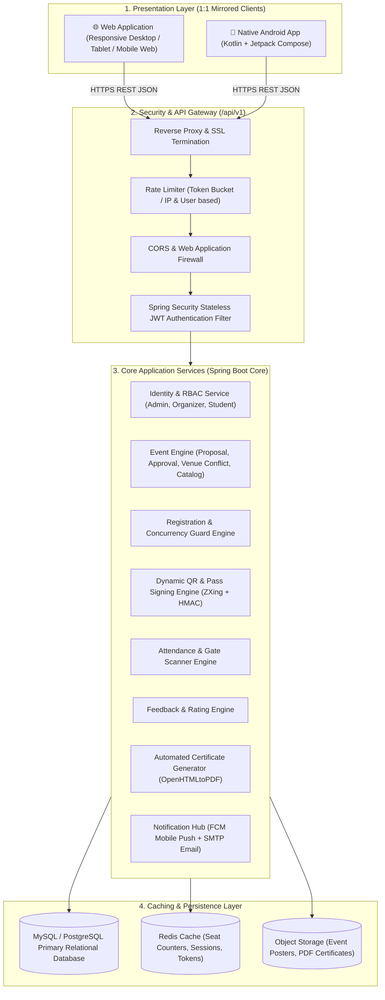
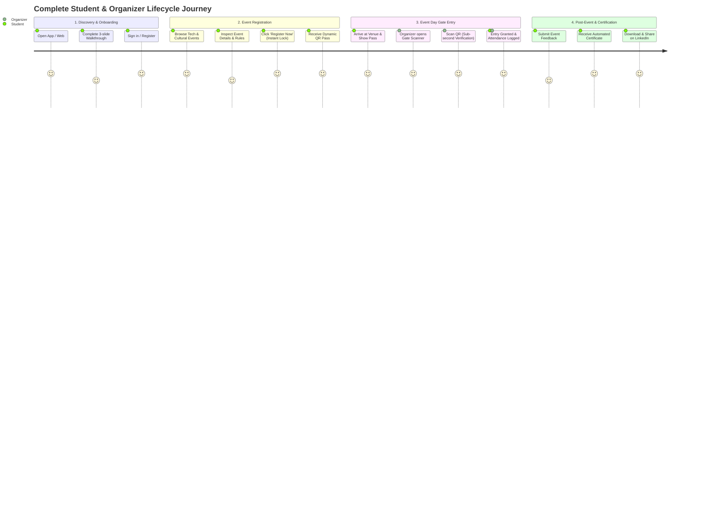

# 🏛️ College Events Management System (CEMS)
## Complete Dual-Platform (Web + Android App) Architecture Specification

> Historical design reference. Current normative architecture is [UNIVERSITY_PLATFORM_ARCHITECTURE.md](UNIVERSITY_PLATFORM_ARCHITECTURE.md) v1.4, with 29 active requirements CF-01..CF-30 except retired CF-12 in [CORE_FEATURES_SPEC.md](CORE_FEATURES_SPEC.md), [schedule/notification contracts](SCHEDULING_AND_NOTIFICATION_SPEC.md), [faculty/volunteer and QR-mode contracts](EVENT_OPERATIONS_AND_ATTENDANCE_SPEC.md), [runtime admin controls and 30-day media deletion](RUNTIME_FEATURES_AND_MEDIA_SPEC.md), [shared-client acceptance](PLATFORM_PARITY_AND_ACCEPTANCE.md) and [agent rules](AGENTS.md). Old event QR-2=EXIT/default-duration, permanent uploaded-file retention and perfect QR protection claims below are superseded; earlier parity/allocation/readiness statements are not verified implementation guarantees. Runtime toggles require implemented compatible clients; protected safeguards remain active. Uploaded originals/derivatives expire 30 days after acceptance, including academic PDFs; external university archives own permanent official files, and explicit legal holds/backup purge follow current policy. Use current contracts for development.

---

## 1. Executive Vision & System Principles
The **College Events Management System (CEMS)** is a synchronized, enterprise-grade platform uniting **Web** and **Android Mobile** environments under a single, robust backend engine.

### Core Architecture Principles
1. **100% Feature, Function & Button Parity:** Every feature, user journey, modal dialog, and action button present in the Web portal exists with the exact same functionality, layout intent, and naming conventions in the Android App.
2. **Single Source of Truth (SSOT):** Both Web and Android consume the exact same centralized REST APIs. Changes made in the Android app reflect instantaneously on the Web and vice-versa.
3. **High-Concurrency Seat Locking:** Zero overbooking through atomic seat decrement at the cache/database layer.
4. **Offline Resilience:** Android app stores tickets and passes in a local encrypted database for instant offline display at entry gates.
5. **Cryptographic Gate Verification:** Dynamic, short-lived HMAC-signed QR passes that cannot be screenshotted or forged.

---

## 2. Omnichannel System Architecture Diagram

---

## 3. Detailed 1:1 Screen, Button & Feature Parity Matrix

Har ek screen, feature, aur button ka exact mapping dono platforms ke liye:

### 3.1 Authentication & Onboarding
| Component / Screen | Web Version | Android App Version | Buttons & Actions (Exact Same) |
| :--- | :--- | :--- | :--- |
| **Walkthrough / Onboarding** | Interactive 3-slide welcome modal on first visit | 3-page horizontal swipe Onboarding Carousel | `[Skip]`, `[Next]`, `[Get Started]` |
| **Login Screen** | Centered glassmorphic card with email/roll no & password | Native Material 3 Login screen with biometric option | `[Sign In]`, `[Forgot Password?]`, `[Create Account]` |
| **Sign-Up Screen** | Multi-field registration form with department & roll number validation | Scrollable form with smart dropdown pickers | `[Create Account]`, `[Back to Login]` |
| **User Profile & Settings** | Top-right avatar dropdown -> profile page | Bottom navigation 'Profile' tab -> settings screen | `[Edit Profile]`, `[Upload Photo]`, `[Change Password]`, `[Logout]` |

---

### 3.2 Student Portal Experience
| Component / Screen | Web Version | Android App Version | Buttons & Actions (Exact Same) |
| :--- | :--- | :--- | :--- |
| **Home / Discover** | Featured hero carousel, category pills (Tech, Cultural, Sports), search bar | Top banner slider, horizontal category chips, instant search bar | `[Search]`, `[Filter by Date]`, `[Explore All]` |
| **Event Details Page** | Full banner, countdown timer, venue map embed, rules accordion, live seat meter | Sticky top image header, countdown badge, venue card, seat progress bar | `[Register Now]` (Dynamic: changes to `[Sold Out]` or `[Registered]`), `[Add to Calendar]`, `[Share]` |
| **My Passes / Registrations** | Grid/List view of active and past registrations with status badges | Vertical cards with swipe actions and status badges | `[View Ticket]`, `[Cancel Registration]` |
| **Digital Ticket Pass** | Modal with full-screen dynamic QR pass, event schedule, seat ID | Full-screen brightness-boosted dynamic QR ticket pass | `[Download PDF Pass]`, `[Save to Gallery]`, `[Close]` |
| **Feedback Submission** | Interactive 5-star rating with tag pills and review textarea | Star rating bar, chip selectors, feedback text field | `[Submit Feedback]`, `[Cancel]` |
| **Certificates Hub** | Certificate gallery with PDF preview modal and verify link | Certificate list with high-res preview and sharing | `[Download Certificate]`, `[Share on LinkedIn]`, `[Copy Verification Link]` |

---

### 3.3 Organizer & Gate Scanner Experience
| Component / Screen | Web Version | Android App Version | Buttons & Actions (Exact Same) |
| :--- | :--- | :--- | :--- |
| **Organizer Hub** | Live statistics (Registered, Checked-in, Remaining seats), Action bar | Dashboard cards with pull-to-refresh live counts | `[+ Create Event]`, `[Open Gate Scanner]`, `[Export CSV/Excel]` |
| **Event Creation Form** | 4-step wizard: Basic Details -> Venue & Time -> Capacity & Rules -> Media | 4-step wizard with bottom navigation & step indicator | `[Previous]`, `[Next]`, `[Save Draft]`, `[Submit for Approval]` |
| **Gate QR Scanner** | Webcam barcode scanner with target box overlay | Ultra-responsive CameraX viewfinder with torch toggle | `[Toggle Flashlight]`, `[Flip Camera]`, `[Enter Roll No Manually]` |
| **Scan Feedback Dialog** | Pop-up card: Green (Admitted) / Red (Already Scanned) / Orange (Unpaid) | Instant overlay card with sound/haptic vibration feedback | `[Confirm Entry]`, `[Dismiss / Scan Next]` |

---

### 3.4 Admin Master Console Experience
| Component / Screen | Web Version | Android App Version | Buttons & Actions (Exact Same) |
| :--- | :--- | :--- | :--- |
| **Admin Overview** | System KPI cards (Total Events, Active Organizers, Student Engagement) | Top metric cards with interactive filter dropdown | `[View Reports]`, `[Pending Approvals]` |
| **Event Approval Desk** | Review table with event details, readiness, and conflict indicators | Swipeable card deck of pending proposals | `[Approve Event (Green)]`, `[Reject with Reason (Red)]`, `[Request Modifications]` |
| **User & Role Manager** | Searchable data table with role assignment dropdowns and status toggles | Searchable user list with role switch sheet | `[Change Role]`, `[Deactivate Account]`, `[Reset Password]` |

---

## 4. End-to-End Walkthrough & User Journey

---

## 5. Technology Stack Specification

| Tier | Web Application | Android Mobile Application | Backend Core & Data |
| :--- | :--- | :--- | :--- |
| **Language** | TypeScript / JavaScript | Kotlin | Java 25 |
| **Framework** | React / Next.js or Spring Boot Thymeleaf + Tailwind | Jetpack Compose (Material 3) | Spring Boot 3.5.x |
| **UI Components** | Tailwind CSS + Lucide Icons + Flowbite | Material Design 3 + Jetpack Navigation | Bootstrap / Tailwind Templates |
| **State / Architecture** | Context API / Redux Toolkit | MVVM + Clean Architecture + StateFlow | Service-Repository Pattern |
| **Networking** | Axios / Fetch API | Retrofit 2 + OkHttp3 + Moshi/Gson | Spring REST Controllers |
| **Local Storage** | LocalStorage + IndexedDB (PWA) | Room Database + DataStore Preferences | Redis Cache |
| **QR / Camera** | Html5-QRCode / ZXing JS | CameraX + Google ML Kit Barcode API | ZXing Core (Java) |
| **Database** | — | SQLite (Room DB for offline cache) | MySQL 8.0+ / PostgreSQL 16+ |
| **Notifications** | Web Push Notifications | Firebase Cloud Messaging (FCM) | Spring Mail + FCM Admin SDK |

---

## 6. Security & Anti-Fraud Architecture

1. **Anti-Screenshot QR Code:**
   * QR passes embed a cryptographic payload:
     $$\text{Token} = \text{Base64Url}(\text{RegistrationId} : \text{Timestamp} : \text{Nonce} : \text{HMAC-SHA256}(\text{data}, \text{Secret}))$$
   * In the Android app, dynamic QR codes refresh every 60 seconds (like Google Authenticator) or are signed with a tamper-evident key.
2. **Preventing Flash-Crowd Race Conditions:**
   * When 500 students click `[Register Now]` simultaneously for 50 remaining seats:
   * Redis atomic `DECR remaining_seats` handles instant capacity reservation before database row locking.
3. **Strict Role-Based API Guards:**
   * Every endpoint is protected with Spring Security annotations (`@PreAuthorize("hasRole('ADMIN')")`, etc.).
   * JWT tokens are passed in `Authorization: Bearer <token>` headers on both Web and Android.

---

## 7. Next Step: Implementation Roadmap

1. **Step 1: Backend REST API Layer Setup**
   * Expose `/api/v1/auth/*`, `/api/v1/events/*`, `/api/v1/registrations/*`, `/api/v1/scanner/*`, `/api/v1/certificates/*`.
2. **Step 2: Android App Foundation (Kotlin + Compose)**
   * Setup project directory, Gradle dependencies, Material 3 theme, and Navigation graph.
3. **Step 3: Screen-by-Screen Development (Web & Android in Parallel)**
   * Implement Onboarding, Auth, Event Discovery, Registration, QR Pass, and Gate Scanner.
4. **Step 4: End-to-End Integration & Real-Device Testing**
   * Validate dual-platform live synchronization and QR pass verification.
