# 🏛️ CUJAMMU-PULSE (Central University of Jammu - Unified Campus, Events & Institutional Life Ecosystem)
## Master System Design & Production Architecture Specification (Web & Android App)
### Version 4.0 — Deep Critical Thinking & Real-World Stress-Tested Edition

> Historical master reference, superseded by [UNIVERSITY_PLATFORM_ARCHITECTURE.md](UNIVERSITY_PLATFORM_ARCHITECTURE.md) v1.4 and 29 active requirements CF-01..CF-30 except retired CF-12 in [CORE_FEATURES_SPEC.md](CORE_FEATURES_SPEC.md). [Schedule/notifications](SCHEDULING_AND_NOTIFICATION_SPEC.md), [faculty/volunteer/QR-mode contracts](EVENT_OPERATIONS_AND_ATTENDANCE_SPEC.md) and [runtime admin controls/30-day uploaded-media expiry](RUNTIME_FEATURES_AND_MEDIA_SPEC.md) are normative under [parity/acceptance](PLATFORM_PARITY_AND_ACCEPTANCE.md) and [AGENTS.md](AGENTS.md). Old mandatory event QR-2=EXIT/default80% and permanent uploaded-file assumptions are superseded. Compatible implemented clients obey runtime toggles without releases; APIs/jobs enforce them while protected safeguards continue. All uploaded originals/derivatives including academic PDFs expire at acceptance + 30 days UTC; official permanent archives are external, with explicit governed legal holds and bounded tracked backup purge. Zero-vulnerability, offline HMAC/public-key and screenshot-proof claims are not certified capabilities. CSV/XLSX, privacy, configurable curfew and geofencing follow the current contracts.

---

## 1. Platform Identity & Vision

* **Official Platform Name:** **CUJAMMU-PULSE**
* **Institution:** Central University of Jammu (CUJammu), Rahya-Suchani (Bagla), Samba, J&K.
* **Core Mission:** A resilient, secure, high-concurrency campus ecosystem uniting 22 Academic Departments, 3 Hostels, Administrative Offices, Central Library, Annual Sports & Cultural Fests, and Student Societies into a single **Web Portal** (`pulse.cujammu.ac.in`) and **Native Android App** (`CUJAMMU-PULSE`) with **100% Feature, Button, and State Parity**.

---

## 2. 10-Loop Critical Thinking & Real-World Friction Stress-Test Matrix

Through 10 recursive deep-analysis cycles, we stress-tested every potential real-world failure mode, institutional conflict, and edge case specific to campus life at CUJammu. Below are the architectural solutions engineered into CUJAMMU-PULSE:

```mermaid
graph TD
    subgraph CriticalLoops ["10-Loop Critical Analysis Matrix"]
        L1["Loop 1: Offline / Network Blackout at Campus"]
        L2["Loop 2: Library Ghost Sessions (Forgot Exit QR)"]
        L3["Loop 3: Proxy Scanning & Remote Screenshot Fraud"]
        L4["Loop 4: Multi-Game Schedule Clashes in Sports Meet"]
        L5["Loop 5: VVIP / Emergency Auditorium Preemption"]
        L6["Loop 6: Community Group Spam, Trolling & Night Noise"]
        L7["Loop 7: Score Card Privacy & Data Protection Leakage"]
        L8["Loop 8: Weather / Rain Disturbance on Sports Grounds"]
        L9["Loop 9: Canteen Escape Loophole in Dual-QR Attendance"]
        L10["Loop 10: Hostel Digital Curfew & Night Gate-Pass"]
    end

    subgraph ArchitectureDefenses ["Engineered Architectural Defenses"]
        D1["Local-First SQLite Cache + WorkManager Batch Sync"]
        D2["Auto-Sweep Midnight Cron + Abandoned Session Tag"]
        D3["Dynamic Rotating TOTP QR (15s) + Campus GPS Geofence"]
        D4["Cross-Sport Fixture Clash Resolver for Referees"]
        D5["Hierarchical Priority Engine + Relocation Assistant"]
        D6["Automated Keyword Moderation + Night-Silence Mode"]
        D7["Isolated Cryptographic PDF Slicer + Signed Ephemeral URLs"]
        D8["Match Freeze & Rain Delay State Machine"]
        D9["Minimum Dwell-Time Math + Mid-Event Mystery Ping"]
        D10["Hostel In-Out Digital Gate Pass & Curfew Logger"]
    end

    L1 --> D1
    L2 --> D2
    L3 --> D3
    L4 --> D4
    L5 --> D5
    L6 --> D6
    L7 --> D7
    L8 --> D8
    L9 --> D9
    L10 --> D10
```

---

### Loop 1: Offline / Remote Campus Network Blackout Defense
* **Scenario:** CUJammu campus in Samba encounters cellular tower instability or Wi-Fi overload during a 1,000-student auditorium entry.
* **Architectural Fix:**
  * **Local-First Cryptographic Manifest:** When the organizer opens the Gate Scanner app, it pre-caches signed attendee public keys and hashes in the local Room Database (SQLite).
  * The scanner can decrypt and verify dynamic HMAC QRs **100% offline without cellular data**.
  * Scans queue in an encrypted SQLite buffer with monotonic hardware timestamps and auto-sync in batches via Android `WorkManager` when connectivity returns.

### Loop 2: Library "Ghost Sessions" & "Forgot to Scan Exit QR" Resolution
* **Scenario:** Student scans Study QR at 10:00 AM, studies, and leaves with friends at 1:00 PM without scanning the Exit QR. Next day at 9:00 AM, they scan again.
* **Architectural Fix:**
  * **Midnight Auto-Sweep Cron:** When library closes at night (e.g., 9:00 PM), unclosed sessions transition to `STATUS: AUTO_CLOSED_UNSCANNED`, capping duration at closing time.
  * When the student scans Entry the next morning, the scanner doesn't block them; it gracefully logs the previous session as `INCOMPLETE_EXIT`, alerts the user with an in-app prompt, and opens today's fresh session.
  * Daily CSV export marks them in Yellow (`Incomplete Exit`), preventing skewed analytics.

### Loop 3: Anti-Proxy Geo-Fencing & Rotating Dynamic QR
* **Scenario:** Student A in the hostel screenshots an entry QR and WhatsApps it to Student B at home to take proxy attendance.
* **Architectural Fix:**
  * **Rotating TOTP QR Display:** The QR code displayed on the library terminal or projector rotates every **15 to 20 seconds** with an encrypted cryptographic time-token (TOTP). A forwarded screenshot expires before it can be scanned.
  * **Dual-Check Geo-Fence:** The student's phone must satisfy either:
    1. Phone GPS coordinates are within CUJammu campus boundary ($\sim$500m radius of venue/library).
    2. Phone is connected to the official campus Wi-Fi network (`CUJ-Campus` BSSID).
    Scans from outside campus boundary are immediately blocked: *"Campus ke bahar se scan anumat nahi hai."*

### Loop 4: Multi-Game Student Schedule Clashes in Annual Sports Meet
* **Scenario:** An athlete qualifies for Cricket Semi-finals and Badminton Quarter-finals on the same afternoon.
* **Architectural Fix:**
  * **Cross-Sport Conflict Matrix:** When sports convenors generate match brackets, the system cross-references all player rosters.
  * If a student is scheduled in two concurrent fixtures, the Referee Dashboard highlights a prominent warning:
    > ⚠️ *"Schedule Clash: Rahul Kumar (22CSIT012) is rostered in Cricket Match #3 (2:00 PM) and Badminton Court #2 (2:30 PM)."*
  * Referees can reschedule or adjust match orders with 1 click before announcing fixtures.

### Loop 5: VVIP / Emergency Auditorium Requisition & Relocation Assistant
* **Scenario:** A student club booked the Main Auditorium for a fest 2 weeks ago. Suddenly, the VC Office or Ministry of Education schedules a high-level National Academic Summit for that exact date and venue.
* **Architectural Fix:**
  * **Hierarchical Role Priority Engine:**
    * Tier 1: VC Office / Registrar / Statutory Institutional Assembly (Priority: 100)
    * Tier 2: Dean of Faculty / Academic Conference (Priority: 75)
    * Tier 3: Department Level Academic Event (Priority: 50)
    * Tier 4: Student Club / Society Event (Priority: 25)
  * **Preemption Relocation Assistant:** When Tier 1 requisitions the venue, the club event is not deleted; the system triggers an automated relocation assistant:
    1. Dispatches an official notice to the club convenor explaining the institutional priority.
    2. Auto-scans available alternative venues (Mini Auditorium, Seminar Hall, Open Air Theatre).
    3. Allows 1-click relocation or rescheduling, automatically updating all registered students' digital passes without re-registration.

### Loop 6: Community Group Moderation, Spam Defense & Night-Silence Mode
* **Scenario:** With 1,000+ students in the "CUJammu Central Student Lounge", spam, ads, inappropriate media, or midnight trolling could disrupt the platform.
* **Architectural Fix:**
  * **Automated Keyword & Toxicity Filter:** Blocks offensive words, hate speech, and external marketing links.
  * **Slow Mode:** Limits students to 1 message every 60 seconds during active hours.
  * **Automated Night-Silence:** Campus-wide groups switch to `Only Admins Can Post` automatically between **10:00 PM and 07:00 AM**.
  * **3-Strike Flagging System:** If 3 users flag a message, it is auto-quarantined into the Admin moderation queue.

### Loop 7: Strict Score Card Privacy & Data Protection Compliance
* **Scenario:** Faculty uploads a batch PDF marksheet. What if Student A alters the API request (`/api/v1/scorecard?rollNo=22CSIT001`) to snoop on Student B's grades?
* **Architectural Fix:**
  * **Cryptographic Slicing & Isolated Vault:** The backend PDF processor slices batch marksheets into individual student PDFs, encrypted with AES-256 and stored in a private object vault.
  * **Strict Principal Enforcement:** Scorecards can only be retrieved if `authenticated_jwt.roll_number == target_roll_number`.
  * Tampering attempts result in an immediate `403 Forbidden` response and an automated security incident log.

### Loop 8: Rain & Weather Delay Protocol for Outdoor Sports Grounds
* **Scenario:** During a Cricket or Football match at the CUJammu Sports Ground, heavy rain halts play.
* **Architectural Fix:**
  * The referee clicks `[Rain Delay / Match Suspended]` on the Live Scoreboard.
  * Current score, overs, and wickets are frozen with timestamped state.
  * Instant push notification is broadcast to all attendees: *"Match suspended due to rain. Resumption time will be notified."*
  * Admin can reschedule the remaining innings to the next morning with 1 tap.

### Loop 9: The "Canteen Escape" Loophole in Dual-QR Attendance
* **Scenario:** Student scans Entry QR-1 at 10:00 AM, walks out to the canteen for 3 hours, and walks back at 1:00 PM just to scan Exit QR-2.
* **Architectural Fix:**
  * **Minimum Dwell-Time Math:** The system calculates:
    $$\Delta t = \text{Exit Timestamp} - \text{Entry Timestamp}$$
    If $\Delta t < 80\%$ of total event duration, certificate eligibility is rejected.
  * **Mid-Event Verification Pulse (Spot Check):** For high-stakes seminars, the organizer can flash a 15-second "Mid-Session Ping QR" on the screen. Students who miss it are marked `PARTIAL_ATTENDANCE` in the final CSV.

### Loop 10: Hostel Digital Night Gate-Pass & Curfew Tracking
* **Scenario:** Students at **Brig. Rajendra Singh MVC Boys Hostel**, **Shyama Prasad Mukherjee Boys Hostel**, and **Sailputri Girls Hostel** currently use paper slips for night curfew, leading to lost slips and manual errors.
* **Architectural Fix:**
  * **Hostel Digital Gate-Pass Module:**
    1. Student submits `[Day-Out Pass]` or `[Night-Out / Leave Pass]` in the app with reason and destination.
    2. Warden approves with 1 tap from their dashboard.
    3. Hostel Security Guard scans the student's in-app Dynamic Pass QR at the gate upon exit and entry.
    4. System computes return time. If returned past curfew (e.g. 7:30 PM for Girls Hostel / 9:00 PM for Boys Hostel), it is logged as `LATE_ENTRY` and flagged for the Warden's review.

---

## 3. High-Level Omnichannel System Architecture

```mermaid
graph TB
    subgraph ClientLayer ["1. Presentation Layer (100% Mirrored Web & Android)"]
        WEB["🌐 CUJAMMU-PULSE Web Portal (Next.js / React / PWA)"]
        APP["📱 CUJAMMU-PULSE Android App (Kotlin + Jetpack Compose)"]
    end

    subgraph SecurityGateway ["2. Security & Gateway Layer (/api/v1)"]
        GATEWAY["Nginx Reverse Proxy & SSL Termination"]
        AUTH_GUARD["Spring Security 6 (Stateless JWT + 2FA + RBAC)"]
        RATE_LIMIT["Redis Token Bucket Rate Limiter"]
    end

    subgraph BusinessCore ["3. Core Business & Automation Engines"]
        DEPT_MGR["22+ Departments & 3 Hostels Dynamic Registry"]
        VENUE_ENG["Smart Venue & Sports Ground Conflict Calendar"]
        EVENT_LIFECYCLE["Event Engine (Scopes, Multi-round, Targeting)"]
        POLICY_ENG["Smart Approval Policy (Auto-Approve vs Ask-First)"]
        ATT_ENGINE["Dual-QR Attendance & Color-Coded CSV Analytics"]
        LIB_GATE["Library Digital Turnstile (Study vs Book Issue Dual-QR)"]
        HOSTEL_GATE["Hostel In-Out Digital Gate Pass & Curfew Engine"]
        CHAT_HUB["WhatsApp-Style Community & Ephemeral Chat Hub"]
        CERT_STUDIO["Smart Certificate Studio (20+ Templates & Auto-Detect)"]
        EXAM_PUSHER["CoE Timetable & 1-Click Roll-No Scorecard Engine"]
        NOTIF_HUB["Omnichannel Push Hub (FCM, Email, SMS, WhatsApp)"]
    end

    subgraph DataStorage ["4. Persistence & High-Speed Cache"]
        PRIMARY_DB[("PostgreSQL 16 Primary Database")]
        REDIS_STORE[("Redis 7 (WebSockets, Seat Counters, QR Nonce, Presence)")]
        OBJECT_STORE[("S3 / MinIO Object Storage (PDFs, Banners, Media, CSVs)")]
    end

    ClientLayer --> GATEWAY
    GATEWAY --> AUTH_GUARD --> RATE_LIMIT
    RATE_LIMIT --> BusinessCore
    BusinessCore --> DataStorage
```

---

## 4. Complete Institutional Entity Master (CUJammu)

### 4.1 The 22 Core Academic Departments (+ Dynamic Extension)
1. Department of Computer Science & Information Technology (CSIT)
2. Department of Mathematics
3. Department of Physics & Astronomical Sciences
4. Department of Chemistry & Chemical Sciences
5. Department of Human Resource Management & Organizational Behaviour (HRM & OB)
6. Department of Tourism & Travel Management (TTM)
7. Department of Marketing & Supply Chain Management
8. Department of Educational Studies
9. Department of Computer Science & Engineering (CSE)
10. Department of Electronics & Communication Engineering (ECE)
11. Department of Economics
12. Department of Public Policy & Public Administration
13. Department of Social Work
14. Department of Comparative Religion & Civilization
15. Department of Mass Communication & New Media
16. Department of English
17. Department of Hindi & Other Indian Languages
18. Department of Environmental Sciences
19. Department of Zoology
20. Department of Botany
21. Department of Molecular Biology
22. Department of National Security Studies
* **Admin Dynamic 'Other' Engine:** Super Admin can add, edit, or reorganize departments anytime via `[+ Add Department]`.

### 4.2 Official Hostels
* **Brig. Rajendra Singh MVC Boys Hostel**
* **Shyama Prasad Mukherjee Boys Hostel**
* **Sailputri Girls Hostel**
* Dynamic controls: `[+ Add Hostel]`, `[Edit Warden / Capacity]`, `[Curfew Timing Settings]`.

### 4.3 Official University Clubs & Societies
* Sports Department, NCC, NSS, DSW Bodies, Hostel Committees.
* 14+ Official Clubs: *Debate & Book Reading, Dramatics, Dance, Music, Creative Writing, Fine Arts, Quiz, Photography & Film, GlamEth-Paridhaan, SPIC MACAY, Innovation & Startup (IIC/E-Cell), Placement Club, Eco Club, Poetry Club*.
* 2-Tier Student Club Approval: Student Proposal $\to$ Department Head Endorsement $\to$ DSW Final Charter.

---

## 5. Dual-Platform 1:1 Screen & Button Parity Matrix (Web vs Android)

| Module | Web Portal (`pulse.cujammu.ac.in`) | Android Native App (CUJAMMU-PULSE) | Exact Matching Buttons / Actions |
| :--- | :--- | :--- | :--- |
| **Onboarding** | 3-Slide Welcome Modal | 3-Page Swipeable Gesture Carousel | `[Skip]`, `[Next]`, `[Get Started]` |
| **Live Venues** | Interactive Timeline Matrix with Filter | Collapsible Day-View Slot Picker | `[Check Availability]`, `[Book Venue]`, `[View Conflicts]` |
| **Library Gate** | Web-cam QR Reader | High-Speed CameraX 60 FPS Scanner | `[Scan Study QR]`, `[Scan Book Issue QR]`, `[Manual Entry]` |
| **Hostel Passes**| Digital Pass Application & Warden Desk | Mobile Gate-Pass with Security QR | `[Apply Night-Out Pass]`, `[Warden Approve]`, `[Scan Gate Entry]` |
| **Event Passes** | Modal with Full Dynamic QR Pass | Brightness-Boosted Dynamic QR Screen | `[Register Now]`, `[Download Pass]`, `[Cancel Registration]` |
| **Gate Attendance**| Web-cam Dual-QR Scanner | CameraX Dual-QR Scanner with Torch | `[Scan Entry QR-1]`, `[Scan Exit QR-2]`, `[Export CSV]` |
| **Community Chat**| WhatsApp-Web Style Split Screen | Native WhatsApp-Style Compose Screen | `[Send Message]`, `[Attach File]`, `[Group Info]` |
| **Score Cards** | Tabular Academic Records | Card-based Grade Viewer with PDF | `[View Score Card]`, `[Download PDF]`, `[Print]` |
| **Certificates** | Certificate Gallery with Preview Modal | Certificate Feed with LinkedIn Share | `[Download Certificate]`, `[Share on LinkedIn]`, `[Verify]` |
| **Admin Desk** | Comprehensive Analytics & Approvals | Mobile Admin Action Center | `[Approve (Green)]`, `[Reject (Red)]`, `[Auto-Approve Toggle]` |

---

## 6. Technology Stack & Verification Standards

* **Backend Core:** Spring Boot 3.5 (Java 25) with Virtual Threads.
* **Web Frontend:** Next.js 14 / React with Tailwind CSS, Lucide Icons, and PWA service worker.
* **Mobile Frontend:** 100% Native Kotlin with Jetpack Compose, Material Design 3, CameraX, and Room Database.
* **Security:** Stateless JWT, BCrypt, HMAC-SHA256 QR signing, AES-256 scorecard encryption.
* **Database & Caching:** PostgreSQL 16 + Redis 7 + MinIO / S3 Object Storage.

---
*Architectural Master Document v4.0 — Project: CUJAMMU-PULSE (Central University of Jammu)*
