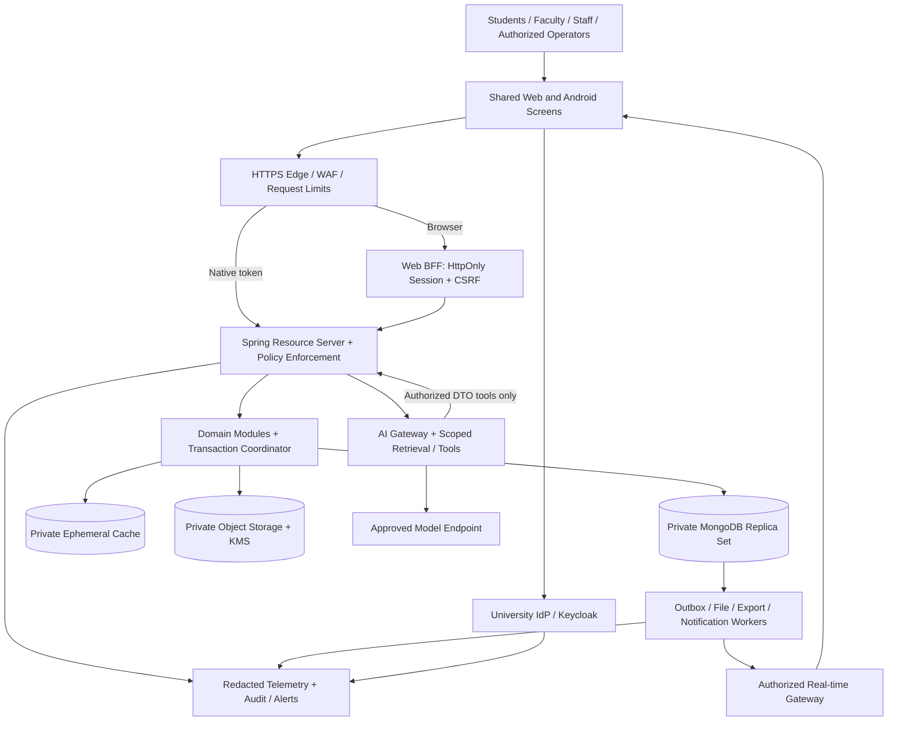

# CUJAMMU-PULSE: Full University Platform Architecture

Version: 1.4 | Decision date: 2 October 2026 | Status: implementation specification, not a production certification.

Owner scope: events, auditorium/facilities, library visits, QR attendance, hostel passes, community chat, sports, teams/judging, alumni, marksheets/timetables, certificates, support, campus feed, notifications, monitoring, runtime administration, uploaded-media expiry and an AI assistant. Phases sequence the current accepted scope.

Read alongside [CORE_FEATURES_SPEC.md](CORE_FEATURES_SPEC.md), [SCHEDULING_AND_NOTIFICATION_SPEC.md](SCHEDULING_AND_NOTIFICATION_SPEC.md), [EVENT_OPERATIONS_AND_ATTENDANCE_SPEC.md](EVENT_OPERATIONS_AND_ATTENDANCE_SPEC.md), [RUNTIME_FEATURES_AND_MEDIA_SPEC.md](RUNTIME_FEATURES_AND_MEDIA_SPEC.md), `PROJECT_ARCHITECTURE_REVIEW.md`, `PLATFORM_PARITY_AND_ACCEPTANCE.md` and `AGENTS.md`. There are 29 active IDs in CF-01..30 excluding retired CF-12; retired IDs are never reused. Version 1.4 adds runtime admin control and 30-day uploaded-media expiry; older scope and permanent-file assumptions are superseded. Version 1.3 refined event QR/evidence rules; library/hostel keep separate workflows. This design does not claim features already exist. Existing source is retained until tested migration and owner-approved cutover.

## 1. Commitments and assurance boundary

- University-controlled identity, verified institutional membership and scoped authority.
- One shared application UI and workflow implementation for Android and web, one versioned business API, one authoritative operational database.
- Every final module/action available on both supported clients with the same labels, information, rules, states and outcome. Platform adapters cannot invent alternative business behavior.
- Personal information protected through minimization, object-level authorization, encryption, controlled exports, lifecycle management and tested incident response.
- Reliable concurrent allocations, auditable state changes, duplicate-safe requests, explicit offline limits and reproducible releases.
- Production status requires recorded verification, independent assessment, named human operational owners and institutional sign-off. No engineer, AI model or tool can prove that undiscovered defects or vulnerabilities will never exist.
- Senior/principal-level accountability is a working standard. AI role names are responsibilities, not claims of a human career, qualifications or 30 years of employment. Independent specialist review supplements agent review.

Unknown institutional policy (approval hierarchy, hostel rules, child/student records, retention exceptions, grading standards, identity provider) is configurable and requires university validation before launch. Do not silently substitute an AI assumption for policy.

## 2. Architecture decisions

| Decision | Selected approach | Rationale / boundary |
|---|---|---|
| Shared clients | TypeScript, Expo, React Native, React Native Web, Expo Router | Same screen/component/route/workflow source; native and browser adapters handle OS APIs |
| Existing Kotlin app | Retain as design/migration reference; replace production UI progressively through tested universal client | Kotlin and an independently authored web UI cannot provide the strongest single-source parity guarantee |
| Backend | Java 21 LTS baseline; supported Spring Boot/Spring Security/Spring Data MongoDB, modular monolith | Preserve domain knowledge; remove giant mixed controller; one transaction boundary where necessary |
| Versions | Pin mutually compatible supported stable releases, lockfiles and image digests during foundation phase | Do not copy a stale version or blindly select latest; verify Boot/Modulith/JDK/Expo/driver compatibility |
| App database | MongoDB replica set as sole primary store for platform domain data | Flexible documents with explicit constraints, transactions and contention guards; no casual SQL-to-document rewrite |
| Identity | Existing university OIDC/SAML provider if adequate; otherwise operated Keycloak federation | Avoid custom password/token infrastructure; verified role provisioning |
| Identity storage | Provider-supported database, separate from app MongoDB; Keycloak ordinarily requires supported relational storage | MongoDB choice does not imply every third-party product supports MongoDB |
| Cache | Redis-compatible managed cache with reviewed licensing/support | Rate limits, ephemeral presence, short-lived caches; never seat/grade/configuration authority |
| Files | Private S3-compatible object storage with encryption, versioning and backup | Files never embedded in unbounded Mongo documents or served from a public uploads directory |
| Async work | Transactional Mongo outbox plus durable worker/inbox | At-least-once delivery and deduplication; no external side effect inside retried DB transaction |
| Live updates | Authenticated WebSocket/SSE gateway with authorized channels; polling fallback | Committed event notifications, not direct access to database change streams |
| AI | Isolated retrieval/tool gateway; model provider approved for university data handling | Model has no database credentials or authority to override access controls |
| Operations | Containerized app/worker, infrastructure as code, private networking and telemetry collector | Managed services or operated university infrastructure; Kubernetes only with staffing and evidence of need |

Expo Router supports unified navigation; this is the basis of the shared-client decision: [official documentation](https://docs.expo.dev/router/introduction/). Spring's modular toolkit can verify boundaries after compatibility review: [Spring Modulith](https://docs.spring.io/spring-modulith/reference/).

## 3. Deployment and trust boundaries



Only edge HTTPS and required identity endpoints are internet-facing. MongoDB, cache, object administration, collectors, dashboards, model worker administration and management ports are private. Separate development/staging/production accounts, identities, keys, buckets, databases and telemetry. Staging uses synthetic/redacted data; never copy live student datasets to developers or agents.

Production topology: at least two app instances and supervised workers across failure domains; three data-bearing MongoDB members across supported failure domains; provider-supported identity HA; encrypted backups in a separately administered location; separate administrative access path with MFA and short-lived credentials. Backups must cover files, database, indexes, identity configuration and encryption-key recovery. Replica sets are not backups. Provider region, data residency and campus/off-campus operation require university approval.

## 4. Identity, authority and privacy

### Authentication

Use OIDC Authorization Code with PKCE, exact redirect URI allowlists, state/nonce checks and issuer/audience/signature/time validation. Disable direct password and implicit flows. Do not put client secrets in app/web bundles. University SSO is the primary path; alumni account linking uses a verified graduation record and verified personal contact, never an email-domain guess.

Browser: BFF keeps OAuth tokens server-side; opaque Secure/HttpOnly/SameSite session cookie, CSRF token and origin verification for mutations. No access/refresh token in localStorage. Native: external system-browser OIDC with PKCE and protected token storage; short-lived access token and rotated refresh token with reuse detection. Link/logout/account disable revoke sessions; enforce authority-version/session-revocation checks for sensitive requests so stale token roles cannot retain privileged access. Privileged users use phishing-resistant MFA/passkeys where supported; recovery and lost-device enrollment require audited identity verification.

Use the same branded login content and application steps on both clients. Identity/OS permission dialogs necessarily use the secure provider or OS surface. This is a documented adapter boundary, not a different platform workflow. [Keycloak OIDC flow guidance](https://www.keycloak.org/securing-apps/oidc-layers).

### Capabilities and scopes

Separate person type from authority. A faculty member can also be organizer or hostel warden; do not give all faculty administrative power. Store grants such as `{subjectId, capability, campusId, departmentId?, eventId?, hostelId?, validFrom, validUntil, grantedBy, version}`. Deny by default; validate principal + capability + scope + resource state on every read/write/export/subscription/tool execution.

| Actor / grant | Permitted scope | Explicit restriction |
|---|---|---|
| Student | Own profile/pass/visits/results; eligible events | No arbitrary roll-number lookup or approval powers |
| Faculty / assigned organizer | Propose/host own approved event; scoped workspace/recruitment/attendance/manual/export duties | Faculty status alone cannot approve own event, publish every result or manage unrelated events |
| Organizer | Owned/assigned events and participant operations | No other event exports or institution-wide marksheets |
| Gate operator / volunteer | Assigned gate/event/session, time-limited scan | Minimal identity display; no bulk student data export |
| Librarian | Assigned library operational reports/corrections | No hostel or grade access |
| Warden | Assigned hostel approvals and exceptions | No other hostel or medical/grade dataset |
| Hostel security | Approved assigned-hostel entry/exit passes | Cannot approve a pass or read detailed private reasons |
| Facility manager | Assigned spaces and resource readiness | Institutional priority requires separately granted authority |
| Judge / referee | Assigned competition/round/match | No self-scoring, unrelated grading or generic admin capabilities |
| Academic uploader / verifier / publisher | Assigned department/program/term | No unreviewed publish; student ownership enforced for retrieval |
| Alumni | Own profile, opt-in directory/mentorship/jobs | No active student visit/hostel/result histories |
| Moderator | Assigned groups/posts/report queue | Access purpose and every sensitive action audited |
| Platform administrator | Service configuration and grant management | Does not automatically gain routine access to private marksheets/messages |
| Security/auditor | Redacted security evidence / approved audits | Content access requires separately justified and logged break-glass workflow |

Authorization belongs in services as well as HTTP routing. Query filters must include institution/campus and authorized resource scope. Do not fetch a broad dataset and hide unauthorized rows in UI. Idempotency keys, guessed IDs and file URLs are not authorization. WebSocket reconnect and queued jobs must reauthorize; background jobs run purpose-limited service identities, not an unrestricted administrator.

### Data governance

Classify fields: public university announcements; internal operational data; confidential personal/contact/visit/hostel information; restricted academic, authentication and incident information. Default new fields to confidential. Maintain purpose, owner, lawful basis/notice, access rules, retention/deletion, processor/provider, location and export rules for each dataset. Uploaded originals/derivatives use immutable 30-day expiry; structured records and evidenced protected holds use their distinct approved policy.

Use stable identity subject plus verified institution identifier with uniqueness, effective department membership and hostel assignment. Separate minimal operational identity from encrypted contact/private fields. Do not collect Aadhaar, precise continuous location, biometrics or guardian contacts without demonstrated approved need. Device biometrics stay on device/IdP; the app receives an authentication result, not raw biometric data. Support under-18 users according to applicable institutional/legal policy before onboarding.

Restricted fields/documents use scoped KMS envelope encryption. Client-side field encryption is evaluated with driver/version/licensing/query constraints. Recovery keys for retained structured records have separate custody; expired uploaded media and its keys must not remain recoverable through archives/backups. Official external archives follow their own governance. Explicit DTO allowlists prevent entity exposure; logs omit secrets/tokens/grades/private content/contact data.

Exports require purpose, appropriate capability and step-up authentication where sensitive; asynchronous private files, expiry, download audit, row/volume limits and CSV formula escaping. Marksheet/private message exports are not routine admin features. Certificate verification reveals minimal approved data and status, with opaque separate verification identifier. Alumni directory disclosure is opt-in with granular visibility and removal.

## 5. Shared frontend and interaction specification

One universal application source: shared routes, screens, design tokens, component library, schemas, i18n keys, action definitions, authorization-aware navigation and domain state machines. Typed generated API client; TanStack Query or equivalent for server state; local ephemeral UI state only for drafts. Backend is authority; no confirmed booking, attendance, effective toggle or result state is invented locally. Evaluated feature manifest removes/restores implemented compatible screens/actions without a code/client update, and corresponding backend checks remain authoritative.

Proposed visual direction: deep university navy, warm gold accents, restrained translucent surfaces, soft depth and clearly legible typography. Floating cards, anchored action dock and assistant affordance create movement and hierarchy. Use transforms/opacity rather than layout thrashing; never float or animate destructive actions across a pointer target. Motion is short and purposeful; reduced-motion disables nonessential movement. No continuous distracting parallax behind forms or results. Tokens define contrast-compliant variants, Light / Dark / Auto (System) themes, spacing, radii, elevation, icons and typography. Persist user preference; Auto follows OS changes. Approved CUJAMMU-PULSE branding and circular logo are shared assets, not independent per-client copies. Prototype theme-switcher.js/Compose implementations are reference behaviors for migration.

Phone app and phone browser use the same layout at matched viewport/font scale. Desktop and tablet use centrally defined responsive breakpoints shared by web/native large screens. Information order, labels, wizard steps, validations and action availability remain the same. Desktop can display the same sections side-by-side using shared responsive rules; no extra web-only features. Role/operator screens, bulk exports, imports, approvals and moderation must also work on phone, using responsive cards and file-picker adapters.

Every screen has: loading skeleton, empty state, success, validation failure, permission denial, retryable failure, offline/read-only mode, stale-data indicator and session-expiry handling. Show pending vs confirmed and conflict resolution explicitly. Prevent duplicate tap submissions, retain accessible drafts and map field errors consistently. Floating assistant cannot cover forms, keyboard, consent, scanner feedback or safe areas. Logout/account switch clears user-scoped query caches, private drafts, previews and subscriptions. Pending operator receipts follow an explicit encrypted isolated quarantine/sync policy; they cannot be exposed to the next account or silently discarded when audit preservation is required.

Meet WCAG 2.2 AA web expectations and equivalent mobile accessibility: keyboard navigation, visible focus, semantic headings/live announcements, contrast, screen-reader labels, touch targets, font scaling, no color-only status, accessible charts/tables and captions/alternatives. English/Hindi initially, shared translation keys and campus timezone/date formatting. Print/download/share actions use the same label and in-app document preview with platform handoff only at the final step.

PWA browser caches only public immutable assets by default; private API responses and marksheets use no-store. Authenticated offline data requires a reviewed scoped cache design. Expo SQLite web support is currently documented as alpha, so do not claim one production SQLite implementation on both clients: use separately tested native encrypted storage and a browser IndexedDB adapter with stronger restrictions for sensitive offline data. Browser JS-accessible storage is not equivalent to a hardware keystore. [Expo SQLite limitations](https://docs.expo.dev/versions/latest/sdk/sqlite/).

## 6. Domain modules and complete workflows

### 6.1 Institutional registry and onboarding

University/campus, departments, programs, batches, clubs, offices, terms, holidays, facilities, libraries and hostels are effective-dated records with stable IDs. Initial approved 22-department config uses idempotent migrations and dynamic selectors. Verified enrollment/HR import needs dry-run/duplicate review. Department/DSW approves club charter/organizer scope. Graduation changes active grants after verification; alumni keep scoped structured certificate/result ownership and external official-archive references where available, not permanent uploaded copies. Account deletion is distinct from grant revocation.

### 6.2 Events and registration

`DRAFT -> SUBMITTED -> CHANGES_REQUESTED / REJECTED / APPROVED -> PUBLISHED -> RUNNING -> COMPLETED -> ARCHIVED`, with authorized cancellation/rescheduling branches. Approval stores a policy version and reviewer decisions. Material edits (venue, capacity, public date, audience) trigger relevant reapproval. Each event has sessions with start/end, facility link, capacity allocation, registration window, audience eligibility, accessibility/resources, attendance and certificate policies.

Student journey: discover/filter -> detail/rules -> eligibility -> shared registration wizard/custom form -> submit -> confirmed or ordered waitlist -> pass -> reminders -> participation -> feedback -> certificate if eligible. Canonical event enrollment is unique by institution + event + person; capacity-controlled session admissions are separate unique institution + session + person allocations. Single-session events create both in the same operation. Multi-session bundles atomically acquire all mandatory allocations in a stable order; optional sessions have separate admission/offer policy. Cancellation, waitlist offers, scan decisions and eligibility use the corresponding session allocation; event-level certificates aggregate required session results. Cancellation is audited; re-registration policy is explicit. FIFO promotion uses a monotonic sequence, not a timestamp tie, and optional offer/accept deadline. No-show release and promotions cannot exceed capacity.

Custom forms have versioned schema, approved field types, limits and server validation; forbid arbitrary executable HTML/JS and sensitive questions without governance. Form submission and registration are one defined operation, not two conflicting registration paths. Speaker/sponsor/volunteer data and delegated scanners have scope, notice and lifecycle rules.

Lifecycle changes follow CF-18: planned changes keep the current schedule until approval; immediate POSTPONED suspends new admission with a date-pending notification; confirmed rescheduling applies a versioned replacement; CANCELLED invokes bounded resource/registration reconciliation. Suggestions are nonbinding snapshots; confirmation rechecks constraints and event/session versions. Safe exit/closure for existing presence remains possible after entry credentials are revoked. See [schedule change specification](SCHEDULING_AND_NOTIFICATION_SPEC.md) for state, audience and capacity contracts.

The current JPA slice appends immutable manager-scoped cancellation/reschedule evidence and exposes `GET /api/v1/cujammu/events/{eventId}/lifecycle/history`; see [ADR_EVENT_SCHEDULE_HISTORY.md](ADR_EVENT_SCHEDULE_HISTORY.md). Lifecycle cancel/reschedule requests accept a UUID request key and optional expected history revision, and persist a command receipt bound to the normalized command payload, so an uncertain retry replays without repeating resource moves, notices or history while a stale workspace fails before mutation; authorization still runs before replay lookup. This legacy slice does not replace reservation contention, durable notification worker processing or Mongo migration evidence; see [ADR_EVENT_LIFECYCLE_IDEMPOTENCY.md](ADR_EVENT_LIFECYCLE_IDEMPOTENCY.md).

### 6.3 Auditorium, rooms and grounds

Calendar shows available, held, awaiting approval, confirmed, maintenance and closure states without exposing private meeting descriptions. Request: facility + event/session + interval + setup/cleanup + attendees + resource needs -> conflict check -> hold/review -> confirm -> resource readiness -> handover -> close/release. Holds expire by server time. Validate end > start, opening hours, capacity, resources, accessibility and all overlap conflicts.

Shared `Venues & Grounds` 24-hour schedule: green Available supports instant transactional booking for eligible requests under approved auto-confirm policy; red Booked shows only permitted event/department data; yellow Pending Review includes blocking hold/expiry semantics. Maintenance/closed overlays remain explicit. Instant conflict feedback and the complete display/action contract are in `CORE_FEATURES_SPEC.md` section 3; a green cached slot is not guaranteed capacity.

Preemption is an exceptional authorized workflow, with second approval where policy requires, reason, affected-booking review, alternatives and notice. Client cannot submit authoritative priority. Relocation must satisfy capacity/equipment, reserve replacement atomically and update sessions/pass metadata; old reservation becomes displaced only through this workflow. No silent deletion or first-conflict-only handling.

### 6.4 QR credentials and event attendance

Implementation note (3 October 2026): the first owner-confirmed credential/intent/evidence backend slice is recorded in [EVENT_QR_IMPLEMENTATION_STATUS.md](EVENT_QR_IMPLEMENTATION_STATUS.md) and [ADR_EVENT_QR_OWNER_CONFIRMATION.md](ADR_EVENT_QR_OWNER_CONFIRMATION.md). It does not yet satisfy the complete client, WebAuthn, offline, report, notification or release gates below; legacy public QR routes remain fail-closed.

Attendance report implementation is tracked in [ATTENDANCE_REPORT_IMPLEMENTATION_STATUS.md](ATTENDANCE_REPORT_IMPLEMENTATION_STATUS.md) and [ADR_ATTENDANCE_REPORTS.md](ADR_ATTENDANCE_REPORTS.md). It provides scoped deterministic CSV/XLSX projections; it does not finalize duration or replace the append-only evidence ledger.

Distinguish two modes selected by event/library policy: (A) authorized staff scans the student's short-lived credential; (B) authenticated student scans a rotating supervised venue challenge. Mode A uses an opaque subject reference. The shared mode B challenge contains action, event/session/facility, purpose, nonce/jti, issued/expiry time and policy version, but no individual student identity; the authenticated server submission binds the student subject into the scan decision/receipt. Never embed personal details or secrets. Device location/network signals are optional corroboration, not proof of identity.

These A/B options are scan transport patterns, separate from event policy SINGLE_QR / DUAL_QR / NO_QR. Required event flow uses A with supervised authorized operators and live credential-owner confirmation; alternate B cannot replace it without an approved equivalent policy. CF-24..28 are fully specified in [EVENT_OPERATIONS_AND_ATTENDANCE_SPEC.md](EVENT_OPERATIONS_AND_ATTENDANCE_SPEC.md): approval opens faculty/organizer workspace and student volunteer recruitment link with mandatory verified roll/enrollment. Master scanner starts OFF; explicit ALL accepted roster (including new accepted members while enabled) or SELECTED scope grants QR access. Manual attendance remains separate, organizer/faculty plus specifically selected volunteers, with supervised identity/reason/evidence.

Use standard asymmetric signed formats and vetted libraries (for example ES256 JWS). Server/KMS alone signs; scanners receive public keys and scoped manifest. Refresh cadence and validity are policy-configured, initially about 30 seconds with an explicit bounded clock-skew allowance; server expiry is always enforced. A screenshot can still be relayed within validity: owner-bound live confirmation, supervised identity checks, scoped devices and replay prevention reduce this risk without claiming impossibility. Event QR has no share/download/print path; supervised non-QR reference/manual admission is the documented dead-phone fallback, not a secretly accepted static attendance QR.

Attendance is an append-only scan ledger plus materialized evidence/presence: ENTRY/ATTENDANCE_CHECKPOINT/EXIT/MANUAL_CORRECTION and approved spot checks, session, subject, authorized scanner/device, credential jti, scanId/idempotency, online server time, bounded device observation time, sync time, decision/reason, verified identifier record and policy version. QR/manual duplicate actions converge on one logical result; duplicate exit never extends duration. Re-entry creates explicit cycles; verified duration intersects valid intervals with session time. A checkpoint proves point presence, not uninterrupted duration. Participation thresholds, mandatory sessions and manual exception authority are explicit.

Certificate generation consumes approved eligibility after event/session closure. Separate CHECKED_IN, PARTICIPATION_ELIGIBLE and CERTIFICATE_ISSUED. Manual correction adds a reasoned compensating record, never deletes the original evidence. Rules cover cancelled/waitlisted tickets, no entry, missing exit, late arrival, early exit, wrong event, revocation and inaccessible devices.

Core modes: SINGLE_QR supports ENTRY_ONLY or ENTRY_AND_ATTENDANCE; DUAL_QR issues entry family at confirmed registration and enables distinct second ATTENDANCE_CHECKPOINT family during an authorized live window; NO_QR uses authorized manual evidence. Second-card activation and scoped notification intent commit together; all confirmed eligible users see their own card, with entry-required state where applicable. QR/window control does not automatically enable scanners. Duration >=80% is an optional frozen evidence policy needing sufficient entry/exit evidence, not an inference from QR count. Status includes REGISTERED, ONLY_ENTRY, ATTENDANCE_CONFIRMED, FULL_ATTENDANCE, EARLY_DEPARTURE, INCOMPLETE, ABSENT and UNDER_REVIEW. No QR sharing/download, short-lived owner-bound proof and supervised checks reduce proxy risk without claiming noncopyability. Final attendance summary and accepted scan log sort globally ascending by verified identifier under versioned natural comparator; preserve leading zeros and private export scope. UI/XLSX colors and CSV status fields convey the same truth.

### 6.5 Library visits

Implementation note (3 October 2026): visit locking, purpose validation, server-anchored duration and midnight repair are implemented in [LIBRARY_IMPLEMENTATION_STATUS.md](LIBRARY_IMPLEMENTATION_STATUS.md) and [ADR_LIBRARY_TURNSTILE_CONCURRENCY.md](ADR_LIBRARY_TURNSTILE_CONCURRENCY.md). Signed facility challenges, physical scan proof, private reports and XLSX remain open.

Library/facility-specific study and issue/return visit purposes; one active visit per subject/library across concurrent requests. Entry/exit use the chosen authorized QR mode and shared scan rules. Occupancy counts ACTIVE visits and states estimates separately. Issue/return visits track purpose only; actual book lending/inventory remains the library system unless an approved integration is added.

Closing scheduler uses actual configured closing time, holidays and Asia/Kolkata policy clock. Auto-closed visits are incomplete/estimated, never verified study duration; next visit is permitted after resolution. Student can request forgotten-exit correction; librarian reviews evidence and logs decision. No public individual study leaderboard or public visitor list. Individual visit history is restricted; aggregate peak occupancy is privacy-reviewed.

Core screen exposes Scan Study QR, Scan Book Issue QR and Confirm Exit; server-anchored live HH:MM:SS timer survives refresh/backgrounding. Same-purpose exit is required; wrong-purpose feedback leaves the visit open and persists mismatch evidence. At 00:00 Asia/Kolkata, durable per-library job exports preceding local day as library_logs_YYYY-MM-DD.csv with private scope, cutoff status, revisions, catch-up/retry and audited downloads. The compatibility GET /api/v1/cujammu/library/export-csv delegates to the authorized report service; localhost is development only. Full schema/date/action contract: `CORE_FEATURES_SPEC.md` section 2.

### 6.6 Hostel passes

Verified current hostel/resident assignment. `DRAFT -> REQUESTED -> APPROVED / REJECTED -> ACTIVE_OUT -> RETURNED / LATE_ENTRY`, with cancel, expiry, extension and exceptional emergency branches. Record expected exit/return, pass type and minimal private reason/destination; detailed reason restricted to authorized warden, not guards. Required consent/guardian workflow, curfew/grace and exceptions are institution-approved configurable rules, not gender assumptions. Core Day-Out/Night-Out forms, warden notification/one-tap reviewed approval and dynamic guard pass are mandatory. Owner-proposed boys 21:00/girls 19:30 examples are per-hostel settings requiring university confirmation; approved extensions/overnight passes define exceptions. Canonical late status is LATE_ENTRY, with old LATE_RETURN values mapped during migration.

Warden authority scoped to hostel; guards scan only approved, unexpired, assigned-hostel passes. Record EXIT before RETURN; revoke/cancel is enforced and duplicate scans are stable. Extensions need authorization before or after due time according to policy. Late status is computed from approved return deadline and configured policy; system does not impose disciplinary decisions automatically. Emergency overrides need justification, notification and subsequent review. Offline use follows bounded revocation policy; uncertain approval is never treated as approved.

The owner-confirmed credential slice is documented in [ADR_HOSTEL_OWNER_CONFIRMED_CREDENTIALS.md](ADR_HOSTEL_OWNER_CONFIRMED_CREDENTIALS.md) and [HOSTEL_IMPLEMENTATION_STATUS.md](HOSTEL_IMPLEMENTATION_STATUS.md). It replaces the legacy raw-token scanner boundary with digest-only rotating EXIT/ENTRY credentials, operator-created short-lived intents, authenticated owner challenge confirmation and append-only gate evidence. The legacy token column remains only for reviewed migration; a displayed QR is never described as non-copyable. Runtime guards, device identity, approved extension policy, durable notifications, native scanner parity and production Mongo/release evidence remain required.

### 6.7 Community chat and campus feed

Legacy bridge implementation decision: [ADR_CHAT_MEMBERSHIP.md](ADR_CHAT_MEMBERSHIP.md) defines explicit department-chat grants, protected OFF-state revocation and bounded directory paging. This implements a subset of the following contract; it does not replace verified institutional identity, MongoDB migration, realtime authorization, moderator governance or hold-aware cleanup.

[ADR_CHAT_POSTING.md](ADR_CHAT_POSTING.md) adds scoped retry keys, payload binding and database-backed posting limits, with explicit legacy-writer drain and client compatibility requirements. Acceptance receipts are distinct from message delivery/read evidence.

Department, club, event and institution groups with explicit membership and moderator grants. REST for history/management plus authorized realtime channels. Message paging/cursors, delivery states, edit version and tombstones; bounded attachments, private signed delivery, malware scanning and report flows. Membership and account status checked on send, read, subscribe and reconnect.

Rate limits by user/group/device with campus-NAT-aware abuse controls; configured slow-mode, quiet hours, announcements-only mode, spam heuristics, report quarantine and appeal. Automated moderation assists humans and records model/rule version; cannot impose permanent discipline alone. Retention/deletion distinguishes ephemeral event chat, official records and legal holds. Never claim end-to-end encryption while performing server-side search/moderation; E2EE would require a separate product/security redesign.

Core Night-Silence is server-enforced [22:00,07:00) Asia/Kolkata with shared countdown/status header and authorized emergency/announcement exception. COMPLETED events prompt authorized organizer: Delete temporary event group? Confirm affects only that event group's access/messages/media/indexes/caches, using audited idempotent cleanup; permanent groups and academic/attendance/certificate records remain intact. Legal holds/abuse evidence and backup retention prevent false promises of immediate universal wipe.

Official victory/results notices require publisher capability and link to approved event/competition outcomes. Personal posts cannot masquerade as official notices. Public posting/directory exposure is explicit. Lost/found claims and helpdesk tickets have owner-scoped threads, confidential details, assigned handling, escalation and closure; possession verification must not publish distinguishing secrets.

### 6.8 Sports and tournaments

The first hardened command boundary is recorded in [ADR_SPORTS_SCORE_INTEGRITY.md](ADR_SPORTS_SCORE_INTEGRITY.md), and accepted-state history in [ADR_SPORTS_SCORE_REVISIONS.md](ADR_SPORTS_SCORE_REVISIONS.md), with open implementation gates in [SPORTS_IMPLEMENTATION_STATUS.md](SPORTS_IMPLEMENTATION_STATUS.md). This partial slice must not be treated as complete until deterministic score replay, reasoned corrections, bracket/resource guards, notifications, client parity and independent release evidence exist.

Sport-specific team rosters, eligibility, match fixtures, referee/scorer assignments and configurable scoring engine. Published fixtures check athlete, official, court/ground and recovery-time conflicts. Bracket generation stores deterministic seed/version and tie-break rules. Live scorer submits ordered events with expected match version; duplicate/out-of-order events do not double-count. Materialized score derived from canonical events; undo is a correction event with permission and reason.

`SCHEDULED -> LIVE -> SUSPENDED -> RESUMED -> PROVISIONAL_RESULT -> FINAL`, plus abandoned/rescheduled branches. Rain delay freezes score and recalculates remaining fixture conflicts. Final result requires authorized confirmation; appeals reopen through defined workflow. Push/SSE informs clients only after commit. Automated promotion to next bracket round happens once and can be corrected through audited reversal. Rules vary by sport; generic text score fields are insufficient.

### 6.9 Teams, judging and prizes

The first hardened judging boundary is documented in [ADR_JUDGING_SCORE_INTEGRITY.md](ADR_JUDGING_SCORE_INTEGRITY.md), with current gates in [JUDGING_IMPLEMENTATION_STATUS.md](JUDGING_IMPLEMENTATION_STATUS.md). Immutable submission/correction snapshots are now specified in [ADR_JUDGING_SCORE_REVISIONS.md](ADR_JUDGING_SCORE_REVISIONS.md); canonical participant binding, appeals, tie-break policy and independent evidence remain open.

Volunteer evidence approval is documented in [ADR_VOLUNTEER_EVIDENCE.md](ADR_VOLUNTEER_EVIDENCE.md), with open gates in [VOLUNTEER_IMPLEMENTATION_STATUS.md](VOLUNTEER_IMPLEMENTATION_STATUS.md).

Managed media expiry is documented in [ADR_MEDIA_RETENTION.md](ADR_MEDIA_RETENTION.md), with open gates in [MEDIA_RETENTION_IMPLEMENTATION_STATUS.md](MEDIA_RETENTION_IMPLEMENTATION_STATUS.md). The public legacy upload handler remains a migration blocker.

Team create/join/invite -> roster validation -> freeze at deadline -> assigned rounds -> scoring -> moderation -> provisional leaderboard -> appeals -> final award. Enforce min/max team size, unique participant constraints, eligibility, roster locks and verified invite acceptance. Organizer cannot choose arbitrary max limits contrary to event policy.

Versioned rubric, score ranges, weight sum and normalization rules; assigned judge only; conflict-of-interest declaration; blind judging where appropriate. Unique score per participant/round/judge/rubric version, autosave drafts, explicit submission lock. Revisions require review trail; final leaderboard excludes drafts, records tie-break and rubric version. Awards drive approved certificates/victory announcements, not raw unreviewed scores.

Core invite display uses CUJ-prefixed codes with secure random entropy, expiry, rate limits and scope; joins never bypass eligibility/team capacity. Default four-parameter rubric is Innovation, Technical Depth, Execution, Presentation (0-25 each; total 0-100), versioned per round. Both clients show permitted live ranking and score breakdown; no disclosure of confidential drafts/judge identity.

### 6.10 Runtime module, feature and function administration

CF-29 exposes Admin -> Module & Feature Controls on both clients with a hierarchical catalog and Enable/Disable switch for every registered business module/feature/function. Authoritative config revision/audit/outbox drives live evaluated manifests and server/API/job/export/AI enforcement. OFF hides ordinary UI and blocks new business actions; ON restores implemented compatible functionality subject to RBAC/dependencies. No code change, rebuild or app update for existing compatible features. Unknown keys/incompatible implementations fail closed; the panel never promises missing code can be enabled. Parent/dependency OFF blocks children; concurrent toggles use expected version/idempotency and authoritative guard contention. Connected propagation target p99 <=5 seconds under measured load; reconnect/polling catches missed updates, while offline devices cannot receive immediate changes. Protect security, admin recovery, required cleanup and safe exit; drain ongoing activity with a visible deadline/owner. Full contract: [RUNTIME_FEATURES_AND_MEDIA_SPEC.md](RUNTIME_FEATURES_AND_MEDIA_SPEC.md).

### 6.11 Marksheets, timetable and academic records

Timetable: department/program/term ownership, versioned publish and notification. Marksheets: uploader stages file -> sandboxed malware/format inspection -> parsed mapping to verified student identifiers -> preview/dry-run -> independent academic verifier -> publisher approval -> per-student immutable result/document version -> owner-only preview/download -> correction/reissue/revoke history.

Quarantine ambiguous roll numbers, duplicate pages, OCR uncertainty, unmatched students and mismatched terms. Never guess a PDF page's student. No automatic publish from an AI extraction result. File processors run with no network, restricted CPU/memory/time, read-only runtime and untrusted input treatment. Original restricted uploads and separated documents remain private and share the upload's 30-day expiry; retain approved structured result/provenance separately. Missing email delivery never changes the academic record's truth. Permanent official originals, when institutionally required, use a separately governed university archive rather than hidden copies in this transient platform.

Academic office defines grade rules, publication embargo, correction authority and statutory retention. Student API uses authenticated subject mapping, not a supplied roll number. Batch download requires exceptional approved capability and audit; general administrators cannot browse results. Notifications say a result is available, never include grades on the lock screen.

Core Score Cards screen shows approved SGPA/CGPA, timetable targeting and View / Download Official PDF / Print actions. One-click batch push means Publish Verified Batch after independent mapping/approval gates; automatic roll detection does not authorize blind publication.

### 6.12 Alumni, certificates and support

Verified graduation/account linking prevents takeover after campus email expiry. Alumni retain authorized structured issued-record ownership; uploaded document copies expire at 30 days, with official originals accessed only through a separately governed external archive where configured. Directory opt-in, purpose-limited search, verified mentorship/jobs and withdrawal apply. Stale student roles cannot grant current campus data access.

Certificate templates are approved versioned assets with issuer/signature authority, unique issuance per eligibility version and separate verification token. PDF generation uses escaped content and sandboxed resource resolution; prohibit external fetch/SSRF. Issue/revoke/reissue ledger and minimal verification endpoint. Helpdesk separates ordinary tickets from confidential security incidents; SLA/escalation and support identity checks are auditable.

### 6.13 Notifications and reporting

Transactional notification intent -> outbox -> provider -> sent/delivered/failed/retry/dead-letter state. Per-channel preferences, quiet hours, emergency authority and deduplication. Email, in-app and native/web push adapters use common event templates; SMS/WhatsApp only after procurement, consent and provider review. Lock-screen notifications contain no sensitive results/reasons. Client inbox is identical on both platforms; channel subscription reflects platform capability.

Reports are scoped and aggregated where possible; pagination and query limits protect database. Search indexes/projections reapply access control and support delete/revocation/expiry. No search cluster or dashboard bypasses private MongoDB permissions.

The full notification catalogue in [SCHEDULING_AND_NOTIFICATION_SPEC.md](SCHEDULING_AND_NOTIFICATION_SPEC.md) is mandatory for every module. Each effective schedule/venue change, postponement and cancellation creates a durable priority inbox intent for affected registered/waitlisted users and assigned staff. Versioned fan-out snapshots, current-access checks, dedupe, expiry, retry/dead-letter and protected delivery summaries prevent silent loss or stale reminders. The current JPA slice adds bounded lease-based reconciliation for the in-app handoff; `RECONCILED` confirms only that the owner-scoped inbox row exists, never provider delivery. Dispatch, provider acceptance, observed delivery, read and acknowledgement remain distinct. Targets are 99% priority inbox creation within 10 seconds and healthy-provider dispatch within 30 seconds under approved measured load; immediate device receipt cannot be guaranteed. Quiet-hours exceptions require institutional purpose/authority; no campus-wide blast for unrelated changes. See [ADR_NOTIFICATION_INTENT_RECONCILIATION.md](ADR_NOTIFICATION_INTENT_RECONCILIATION.md).

The current implementation records an atomic `IN_APP` delivery intent for each inbox row; see [ADR_NOTIFICATION_INBOX_INTENT.md](ADR_NOTIFICATION_INBOX_INTENT.md) and [NOTIFICATION_IMPLEMENTATION_STATUS.md](NOTIFICATION_IMPLEMENTATION_STATUS.md). Provider delivery, audience snapshots and worker reconciliation remain release gates.

### 6.14 Volunteer hours, lost/found and numbered helpdesk

Core volunteer hub includes shifts/tasks, submitted hours, supervisor-reviewed nonoverlapping credited time and one certificate decision after approved completion. Lost/found includes category chips, quarantined photos, confidential claim evidence, verified handover and unique accepted claim history. Helpdesk intake is 24/7 with private grievance thread/status/escalation; actual responder SLA depends on staffing. Display CUJ-TKT-YYYYMM-XXXX uses atomic monthly counter (width expands beyond 9999), opaque internal ID and owner-scoped access. Detailed actions and safeguards: `CORE_FEATURES_SPEC.md` section 8.

### 6.15 Audience choice polls

Legacy bridge implementation decision: [ADR_AUDIENCE_POLLS.md](ADR_AUDIENCE_POLLS.md) defines scoped draft/publish/close commands, immutable votes, private receipts and additive compatibility boundaries. It implements part of CF-17; realtime delivery, durable audience notifications, reviewed finalization and production MongoDB evidence remain required.

Core poll lifecycle: draft -> reviewed/published -> open voting -> closed -> finalized result, with audience/session and server-controlled windows. One accepted vote per institution + poll + authenticated subject, unique index and atomic vote/tally/outbox; immutable default choice, idempotent retries and reviewed disqualification. Realtime percentage/count bars derive from committed eligible votes with clear zero-vote/rounding rules. Voter identities remain private. IP/device signals support minimized abuse review, not one-vote-per-IP: campus NAT is shared. Trust proxy configuration, retention, scope and backend rules cannot be bypassed from another client or by changing phone clock.

### 6.16 Smart campus operations and continuity

CF-20 provides a private personal campus agenda with approved timetable/event/duty integration, unknown-data indicators, safe clash warnings and revision-aware calendar updates. CF-21 adds owner/due-date readiness tasks, capacity/staffing/accessibility checks, resource suggestions and fair waitlist reminders. CF-22 adds optional feedback and scoped aggregate operational insights with small-group privacy protection; explain freshness/limitations and keep adverse decisions human-reviewed. CF-23 adds verified facility/campus closure windows, dependency impact previews, organizer review tasks and supervised outage recovery. These features use the existing modular monolith/shared client; no unnecessary microservices or unrestricted AI authority. Complete contracts are in [SCHEDULING_AND_NOTIFICATION_SPEC.md](SCHEDULING_AND_NOTIFICATION_SPEC.md).

### 6.17 Uploaded media expiry and storage operations

CF-30 applies uploadAcceptedAt +30 UTC days to all uploaded images/audio/video/PDFs and inherited thumbnails/previews/processor copies, including academic documents. Access is denied at expiry independent of worker timing; durable purge tracks original versions, replicas, caches, search/vector fragments, temporary files and recovery copies. Private delivery cannot outlive media expiry. Re-enable/edit/view never extends retention or resurrects deleted data. Authorized evidenced preservation holds are explicitly HELD exceptions. Transient media is excluded from long-lived system backups; restore replays expiry/deletion evidence. Physical purge target p99 within 24 hours after expiry is measured, not a promise of instantaneous byte destruction. UI shows expiry/expired placeholders; structured records remain under distinct approved retention. Validate provider versions/backups and irreversible-erasure criteria before release. Compression, bounded derivatives, quotas and orphan cleanup reduce storage safely. Full contract: [RUNTIME_FEATURES_AND_MEDIA_SPEC.md](RUNTIME_FEATURES_AND_MEDIA_SPEC.md).

## 7. MongoDB schema and correctness contract

MongoDB supports multi-document transactions on replica sets; that capability does not automatically enforce business invariants. [MongoDB transaction documentation](https://www.mongodb.com/docs/manual/core/transactions/).

Use explicit schema validators, versioned migrations, repository-owned query builders and projected DTOs. Every operational record includes institutionId, stable opaque ID, schemaVersion, created/updated audit fields; mutable aggregates include version. UTC instants stored as dates; academic/hostel local policy timezone stored explicitly. Bounded embedded value objects; references for large history, memberships, messages, scans and entries. Never an ever-growing users.messages/events.participants array.

| Collection group | Key constraints / authority |
|---|---|
| people, memberships, grants | Unique institution + issuer/provider + IdP subject; partial unique verified institutional identifier; scoped effective grants |
| institutions, campuses, departments, terms, clubs, hostels, facilities, libraries | Stable IDs, normalized unique active codes; effective-date history |
| events, sessions, inventories, registrations, sessionAllocations, waitlistOffers | Unique institution + event + person enrollment; unique institution + session + person admission; nonnegative session capacity; monotonic inventory queue sequence |
| calendarGuards, bookings, resourceReservations | Shared guard per facility/resource; interval validity and transaction overlap check |
| qrCredentials, scanEvents, presence, libraryVisits | Unique institution + scanId; replay state by purpose/session/action/credential; partial unique ACTIVE visit |
| hostelPasses, hostelMovements | Resident/hostel scope; current state CAS; unique movement idempotency |
| groups, groupMembers, messages, reports | Unique group + member; bounded history paging; author/member ACL |
| teams, teamMembers, fixtures, matchEvents, matchState | Roster constraints; unique event + match + sequence/eventId; expected state version |
| rubrics, judgeAssignments, scores, finalResults | Unique round + participant + judge + rubric; submitted score immutability |
| polls, pollVotes, pollTallies | Unique institution + poll + voter subject; eligible server-time submission and transactional counts |
| volunteerShifts, volunteerHours, lostFoundItems, claims, supportTickets, ticketCounters | Approved nonoverlapping credits; unique handover; owner scope; atomic monthly display sequence |
| eventOperations, volunteerRecruitment, volunteerApplications, volunteerMemberships | Unique approved workspace and event/subject membership; verified identifier ownership; accepted roster scope |
| attendancePolicies, attendanceWindows, scannerControls, scannerGrants, manualAttendanceGrants | Frozen mode/evidence; default OFF; action/window/epoch checks; QR/manual/export rights independent |
| eventCredentialRecords, pendingScanIntents, attendanceDecisions | Private identifier references; owner proof; bounded nonce expiry; unique accepted action/cycle; control/lifecycle revocation contention |
| themePreferences, brandingVersions, reportJobs, reportArtifacts, cleanupJobs | Shared settings; unique institution/library/date/revision; scoped snapshots and idempotent jobs |
| featureDefinitions, featureConfigurations, featureConfigRevisions, featureChangeJobs | Registered business action coverage; scoped effective revisions/dependencies; atomic toggle/audit/outbox and bounded drain |
| mediaLifecycleMetadata, mediaPurgeJobs, mediaDeletionLedger, preservationHolds | Immutable upload/lineage expiry; deny-at-expiry; idempotent all-copy purge; protected exceptions and restore replay |
| academicBatches, resultVersions, documentMetadata | Unique approved student + term + result version; active publication pointer updated atomically |
| alumniProfiles, mentorships, jobs, certificates, tickets | Ownership/visibility; unique issuance key; verification token hash |
| idempotencyRecords, outbox, inbox, notificationDeliveries | Unique scoped operation key/event ID; durable claim/retry and dead-letter |
| scheduleChangeRequests, scheduleRevisions, suggestionSnapshots, institutionCalendarBlocks, resourceAssignments | Expected lifecycle revision; bounded nonbinding suggestions; all booking/resource mutations share guards; private conflict details |
| notificationIntents, notificationRecipientSnapshots, notificationAcknowledgements, reminderJobs | Unique intent + recipient inbox; resumable audience batches; subject-owned acknowledgement; stale revisions suppressed |
| readinessTasks, feedbackResponses, disruptionNotices | Assigned scope/owner; subject-scoped feedback; approved notice authority/windows; privacy-preserving aggregate access |
| auditEvents, incidentRecords, retentionJobs | Append-only controlled write path; external immutable audit copy; legal-hold awareness |

### Capacity allocation

Short transaction: authorize and validate window/eligibility; resolve idempotency key and request hash; conditional update session inventory where remaining >0; insert unique enrollment and session allocation/transition existing cancelled allocation according to policy; insert audit/outbox; commit majority. Exhausted inventory creates ordered waitlist, never negative counters. Waitlist enqueue allocates queueSequence through atomic increment on that same inventory aggregate inside the transaction even when capacity allocation fails; FIFO means the committed server-assigned sequence, not an invented ordering of simultaneous client clicks. Cancellation and promotion update the same inventory document within the transaction; reserved offers count against capacity. Retry transient conflicts with bounded backoff; unique constraints catch duplicate participant submission. Reconcile counters against allocations/holds and alert on drift, never blindly overwrite during active allocation.

### Interval reservations

Every booking mutation affecting a facility must write its calendar guard/version in the same transaction BEFORE evaluating all interval overlaps including buffers and nonexpired holds; then insert/update booking and linked session/audit/outbox. Updating the shared guard creates contention between conflicting snapshots. Query-overlap-then-insert in separate documents, even inside snapshot transactions without this shared write, can produce write skew. Multi-facility/resource bookings acquire guards in stable order. All cancellation, hold expiry, reschedule, maintenance and preemption paths must use the same coordinator. Revalidate all conflicts on retry. Test under concurrent barriers, not sequential mocks.

### Other invariants

- Scan decision and presence projection update atomically with unique operation ID; repeated exit never changes first accepted exit. Server enforces expiry even if a credential record still exists. Library ACTIVE visit creation/closure and any stored occupancy projection update in the same transaction; partial uniqueness alone does not maintain the counter.
- Idempotency receipt uniqueness includes institution, principal, operation and scope; store canonical request hash and original safe response. Reusing a key with a different payload returns conflict. Outbox claims use leases, attempt counts and claim-version/fencing checks; an expired worker cannot acknowledge a newer worker's claim.
- TTL indexes are eventual cleanup, not security expiry, hold release, quiet-hour enforcement or legal deletion guarantee. Application filters by server expiry and scheduled compensating transitions release capacity.
- Transaction callback contains no email, push, LLM or file upload. Outbox written in transaction; worker dispatches after commit, at least once. Consumer inbox and provider idempotency prevent repeated side effects where supported. Unknown external delivery is reconciled, not labelled exactly-once.
- Academic files are generated/uploaded outside the transaction, scanned, ownership-mapped, checksummed and staged before publication. Freeze independently approved batch/version; transaction verifies approved staged artifacts are unexpired and atomically flips publication pointer with audit/outbox. Unpublished/orphan staging objects follow inherited upload expiry, never become visible results. Media processor completion and feature-disable races recheck authoritative state/versions before publishing.
- Snapshot reads, majority writes for critical transactions; precreate collections/indexes, bounded transaction size/time, driver-supported retry/unknown-commit handling. Avoid sharding until justified; reassess unique indexes, routing and contention if sharded.
- Private MongoDB, authenticated clients, TLS, least-privilege runtime users, separate backup/migration identities, auditing and encrypted storage. Mongo role permissions do not replace application document-level authorization.

## 8. API and realtime contracts

OpenAPI versioned `/api/v1`; generated TS clients and shared validation models. Typed requests/response DTOs; problem-details errors with safe codes, field messages and correlation ID. Cursor pagination, limits, query allowlists and no arbitrary Mongo operators from clients. Do not expose database entities or raw pipelines. Mutations require idempotency key where retried; resource changes use expectedVersion/If-Match. Return 401 unauthenticated, 403 forbidden, 409 state/version/conflict, 422 semantic validation, 429 quota and safe transient error responses.

Route families: `/me` (including theme preference/features), `/registry`, `/events`, `/sessions`, `/registrations`, `/facilities`, `/bookings`, `/attendance/scans`, `/libraries/visits`, `/hostel-passes`, `/chat/groups`, `/feed`, `/teams`, `/competitions`, `/matches`, `/judging`, `/polls`, `/volunteers`, `/lost-and-found`, `/academic/batches`, `/academic/results/me`, `/alumni`, `/certificates`, `/tickets`, `/notifications`, `/reports`, `/assistant`, `/admin/policies`, `/admin/features`, `/media`, `/admin/media/storage`, `/security/incidents`. Actions have explicit intent rather than unrestricted new status strings. Removed-module routes are not part of the target. Legacy library export delegates to the same authorized service.

Realtime envelopes include eventId, resourceId, resourceVersion, type and safe payload. Subscribe requires current scope; unauthorized joins cannot probe channel existence. Browser channels terminate through same-origin BFF with session authentication and origin checks; native channels use authenticated transport. Never place long-lived bearer tokens in WebSocket URLs/query strings or logs. Order per resource, dedupe event IDs, reconnect using cursors and refresh canonical state after gaps. Redis pub/sub may provide low-latency hints, but durable state/outbox supports recovery. Disconnect clears subscriptions; account/grant revocation and expiry invalidate channels. Notification payloads are not trusted as mutation authority.

Client compatibility is a release contract: API/DTO/registry versions, supported minimum clients and backward-compatible transitions are recorded. Staged signed native releases and signed reviewed OTA updates have rollback/kill switches and native-runtime compatibility checks; never OTA-push an incompatible native dependency. Web updates and installed-app rollout are coordinated. Enable new workflows only for compatible clients while preserving supported old/in-flight journeys; incompatible high-risk operations show upgrade guidance and are safely blocked. Version strings/client claims do not substitute for authentication or security enforcement.

Lifecycle command APIs additionally include explicit event/match postpone, suggestions, schedule-change approval and cancellation; acknowledgement/delivery-summary, own calendar, readiness, feedback and disruptions. Version preconditions, idempotency and capability checks are required. Every registration/scan contends on the applicable lifecycle version so cancellation/rescheduling races cannot create a post-cancel admission. Long-running bundle changes use an exposed frozen CHANGE_IN_PROGRESS workflow with compensation rather than partial public success.

Event operations/recruitment, session attendance policies/windows, scanner control/delegation, manual grants, owner credentials/scan-intent confirmation and ascending report APIs follow [EVENT_OPERATIONS_AND_ATTENDANCE_SPEC.md](EVENT_OPERATIONS_AND_ATTENDANCE_SPEC.md). Each accepted action rechecks applicable lifecycle/window authority: QR additionally requires master and operator membership/grant; manual requires its independent manual window and organizer/delegate authority, not QR master ON or organizer volunteer membership. These checks contend against concurrent revocation in the transaction. Manual lookup is confined to confirmed event roster; QR/manual permission does not imply export. New high-assurance event scanning is online by default; offline behavior remains explicitly provisional.

## 9. Offline and QR gate operation

Offline personal passes and offline authorized scanning are different capabilities. Cached pass metadata is scoped, encrypted where supported, short-lived and labelled stale; restricted marksheets/chats/hostel reasons are not cached by default. Logout removes local sensitive state and subscriptions; device disable revokes enrollment. Server cannot guarantee immediate erasure from an already offline/stolen device, hence minimized data and bounded validity.

Before event, authorized operator enrolls device, downloads minimal signed event/session manifest and public key set, approved/revoked credential snapshot, policy epoch and expiry. Scanner queues signed/attested operator-device records with unique scanId, local monotonic sequencing, observed time and sync state. Device clocks and attestation are evidence, not absolute trust. Work persists across restart; sync reauthorizes device and validates original event/policy evidence, duplicate/revoked records and clock skew. Offline token validity is evaluated against a bounded credible observed scan time and manifest/revocation rules, not blindly against the later sync timestamp; uncertain clocks require review. A disconnected client cannot mint fresh server-signed rotating credentials or venue challenges. Offline presentation uses explicitly preissued bounded credentials/supervised fallback policy; it never silently relaxes the online dynamic credential rule.

For multi-gate admission: campus LAN coordinator preferred. Otherwise assign disjoint credential/gate partitions; if neither available, admit only under institution-approved provisional policy with supervisor and reconciliation. Disconnected scanners cannot promise global duplicate detection or immediate feature-disable propagation. Offline evidence is provisional until reconciliation. Critical unknown/revoked hostel approvals, marksheet publication, runtime administration and venue booking remain online-only. Browser offline scanner uses a verified adapter and may require online coordination rather than weaker security.

## 10. AI assistant and ML boundaries

The initial assistant containment guardrails are recorded in [ADR_AI_ASSISTANT_GUARDRAILS.md](ADR_AI_ASSISTANT_GUARDRAILS.md), with remaining production gates in [AI_ASSISTANT_IMPLEMENTATION_STATUS.md](AI_ASSISTANT_IMPLEMENTATION_STATUS.md). The guardrails do not authorize private retrieval, tools or adverse decisions.

Same assistant entry point, conversation UI, citations, feedback and escalation on both clients. Initial tasks: explain approved university policies, find published events/venues, guide navigation and show a user's own ticket/status through authorized DTO tools. Support English/Hindi/Hinglish and accessible text input; voice is optional reviewed adapter. Do not use AI to determine authority, award disciplinary action, publish marksheets, approve expenses or certify security.

Data pipeline: approved source ingestion -> malware/content validation -> provenance/version/effective dates -> ACL labels -> curated chunks -> approved embedding service -> institution-scoped index -> authorization-filtered retrieval -> constrained answer with source links and freshness. Separate public/internal/restricted corpora and indexes where necessary. Permission filtering occurs before model context and again before tool/document delivery. Academic/private hostel data excluded from general vector indexes and training. Caches key by institution, user/scope version, corpus/model/prompt versions; never serve one user's private answer to another.

Gateway enforces identity, purpose, quotas, deadlines, context limits, allowed model/provider, region/retention contract and redaction. Model has no database, shell, object-store key, internet browsing or arbitrary HTTP tool. Retrieved text, attachments and user prompts are untrusted data; cannot change system/tool policy. Allowlisted tools use schema validation and server-derived principal; model-supplied user IDs do not establish permission. Write tools, if added after read-only pilot, create preview/intents and require explicit user confirmation plus ordinary server authorization; no high-risk autonomous writes.

Answer uncertainty explicitly, cite approved evidence and escalate to office/helpdesk. Prompt injection, role impersonation, malicious PDF, sensitive-data disclosure, cross-user cache and tool abuse tests are release gates. Retrieval/logging capture minimal redacted traces; full prompts require controlled debugging consent and retention. Model provider must have approved no-training/data-handling terms for allowed data; otherwise only public/redacted content may leave university systems. Do not claim a prompt or filter makes LLM leakage impossible.

ML anomaly signals can prioritize spam/fraud/operator anomalies; human review required for adverse decisions. No student surveillance score or automatic disciplinary inference from study time, location or attendance anomalies. Evaluate multilingual quality, false positives, retrieval permissions and model updates before rollout. Keep provider credentials only in secrets manager; allow a non-AI search/help fallback and an AI kill switch.

## 11. Security controls and threat coverage

| Threat | Prevent / limit | Detection / response |
|---|---|---|
| Account takeover | SSO, passkeys/MFA, scoped sessions, secure recovery | Login/session anomalies; revoke sessions and reset enrollment |
| IDOR / bulk student disclosure | Service-level scoped policies, DTOs, pagination, export limits | Denied-access enumeration and abnormal read/export volumes |
| Insider abuse | Separation of duties, no universal content admin, step-up, break-glass review | Immutable access/export/grant audit; independent review |
| Database/file theft | Private network, encryption, minimal runtime privilege, KMS separation | DB access/config alerts; contain identities and rotate affected keys |
| XSS/CSRF/injection/SSRF | Escaping, CSP without production unsafe-eval, CSRF/origin controls, typed Mongo queries, egress allowlist | WAF/application signals and DAST; disable affected upload/tool path |
| Malicious files/PDF | Quarantine, limits, sandboxed parser, malware scan and no active content | Scanner/worker errors; block publication and retain forensic evidence |
| Proxy/replayed QR | Short expiry, asymmetric signatures, scoped gates, nonce/scan dedupe, supervision | Replay/device/clock anomaly; quarantine and manual review |
| Allocation/configuration manipulation | Atomic invariant transactions and scoped configuration authority | Counter/config-revision reconciliation and drift alert |
| Chat/AI exfiltration | Membership controls, minimized model context, ACL retrieval/tools | Report queue, redacted tool-denial/anomaly telemetry and kill switch |
| Supply-chain compromise | Reviewed pinned dependencies/actions, SBOM, signatures/provenance, minimal CI credentials | Advisory and artifact verification; block deploy, rotate exposed CI credentials |
| Ransomware / outage | Separate immutable backups, least privilege, restore drills and degraded modes | Backup-age/failover/queue alerts; tested DR and incident runbook |

Engineering baseline: OWASP ASVS Level 2 across platform, selected higher-assurance controls for identity/academic/administration, OWASP API Security and mobile verification standards mapped to tests. No certification claim from an automated scan. Independent authenticated assessment before launch, after major trust-boundary changes and periodically per institutional risk policy.

Threat model includes compromised student browser, stolen device, faculty/organizer insider, malicious file/source, shared network, leaked CI token, compromised dependency/processor/provider and backup theft. Availability/fraud/privacy risks are tracked together. Signed build and secure infrastructure reduce but do not eliminate malicious privileged-provider risk.

## 12. Continuous monitoring and incident response

Application instrumentation -> private OpenTelemetry collector -> redaction/cardinality limits -> metrics, logs, traces and security event store. Immutable audited events are separately retained with restricted writer and external WORM/tamper-evident copy; hash chains alone are insufficient if an attacker controls all keys/storage. Use pseudonymous identifiers and safe correlation IDs. [Collector architecture](https://opentelemetry.io/docs/collector/).

Dashboards: service latency/error/saturation; event admission throughput; replica health/lag/transaction retries; outbox/notification lag; calendar/capacity reconciliation; library stale sessions; hostel unresolved exceptions; academic publishing errors; file quarantine; AI failures/denied tools; provider and backup health. Availability probes use dedicated synthetic identities without real data. Public health reports minimal status; diagnostics require private authenticated access.

Proposed launch SLOs, to be ratified and measured: monthly user-facing availability >=99.9%; online scan decision p95 <=800 ms; ordinary API p95 <=500 ms excluding long jobs; API p99 <=2 s; committed event-to-client p95 <=2 s; 1,000 concurrent campus users and 20 online scans/second sustained in a realistic load profile. These are acceptance targets, not measured capacity claims. Build load tests from agreed actual enrollments/events and document environment, duration, p95/p99, error rates, hot-key contention and headroom.

Initial DR targets: structured operational RPO <=15 minutes / RTO <=4 hours with actual backup configuration and quarterly restore evidence; approved structured academic records need ratified durable-copy controls. Uploaded media remains transient with original 30-day expiry, excluded from long-lived recovery copies; restore must enforce deletion ledger and hold rules. Official external archives have separate governance. Do not promise zero data loss without evidence; test restore, not just backup creation.

| Cadence | Required operational work |
|---|---|
| Continuous | Service/security signals, private DB/object-store configuration, queue health, synthetic availability and relevant threat alerts |
| Every change | Tests, dependency/secret/IaC/container scans, policy/parity contract checks, SBOM and artifact verification |
| Daily | Failed jobs/backups, anomalous access/export, capacity/calendar reconciliation, dead-letter and device revocation review |
| Weekly | Dependency advisories, suspicious grants, retention jobs, restore sampling, moderation/AI false-positive review |
| Monthly | Access recertification, secrets/keys/cert expiry, least-privilege review, resource/cost/SLO reports and incident trend review |
| Quarterly / major release | Disaster recovery exercise, threat-model update, security/parity audit and institutional office sign-off |

24/7 meaningful alerts require named on-call coverage, escalation and deduplication; dashboards without responders are not monitoring assurance. Critical security/availability alerts target acknowledgement within 15 minutes as an operational staffing requirement. Suspected leakage: contain compromised credentials/exports, preserve protected evidence, establish scope, notify security/privacy leaders, assess legal reporting, communicate through authorized office, recover verified artifacts and complete post-incident corrective review. Do not ask an LLM to autonomously alter production access policies.

India legal applicability is assessed by university counsel/privacy officer, with effective-date register. DPDP commencement is phased, so this design targets substantive safeguards without asserting every obligation is already effective on this document date. For covered entities, CERT-In directions include reporting listed incidents within six hours of noticing/being informed, rolling 180-day ICT logs within Indian jurisdiction, designated contact and synchronized clocks. Map university/provider applicability explicitly and track DPDP notifications/retention separately as they commence/apply. Statutory retention and data-minimization exceptions must be documented, not overridden by a generic delete policy. [CERT-In official directions](https://www.cert-in.org.in/PDF/CERT-In_Directions_70B_28.04.2022.pdf), [DPDP commencement](https://www.meity.gov.in/static/uploads/2025/11/c56ceae6c383460ca69577428d36828b.pdf).

## 13. Engineering layout and integration boundaries

Target layout is additive until migration succeeds:

```text
apps/universal/                    shared Expo routes/screens + platform adapters
packages/design-system/            tokens, components, themes, motion/accessibility
packages/contracts/                generated DTO/API client + event schemas
packages/workflows/                shared UI state machines/action definitions
packages/i18n/                     labels/content keys
services/platform/                 migrated Java domain modules
services/platform/.../identity/
services/platform/.../events/
services/platform/.../facilities/
services/platform/.../attendance/
services/platform/.../library/
services/platform/.../hostels/
services/platform/.../community/
services/platform/.../sports/
services/platform/.../judging/
services/platform/.../polls/
services/platform/.../volunteers/
services/platform/.../support/
services/platform/.../featurecontrol/
services/platform/.../medialifecycle/
services/platform/.../academics/
services/platform/.../alumni/
services/platform/.../documents/
services/platform/.../notifications/
services/assistant-gateway/         isolated model/retrieval boundary
infra/                             reproducible environments, no secrets
docs/adr/                          decisions and review evidence
docs/runbooks/                     incident, backup, migration, gate operations
tests/                             policy, contracts, parity, load, security
```

One deployable domain app can contain separate Java packages with public module interfaces; workers may share code with separate restricted identities. No cross-module direct repository access except explicit reviewed transactional coordinator. Dependency direction enforced with architectural tests. Assistant/file processors separated by runtime trust boundary, not by gratuitous microservices. Public chatbot/AI endpoint cannot bypass authenticated service APIs.

Campus ERP/library/HR/IdP/official-archive integrations use scoped credentials, authenticated transport, provenance, retry/reconciliation and dry-run imports. Each has an institutional owner and outage behavior. Development MCPs/plugins are not automatically trusted production integrations.

## 14. Delivery plan with no scope deletion

| Stage | Deliverables | Exit evidence |
|---|---|---|
| 0: Baseline and policy | Source inventory, existing changes protected, synthetic dataset, threat model, office-owned policy register and ADRs | Verified source/build baseline, defect inventory, no real-data exposure |
| 1: Secure foundation | Reproducible build, IdP/scoped policy, shared client shell/design tokens, Mongo replica schema/indexes, private storage, outbox, telemetry/CI | Auth/negative-access tests; schema/transaction proof; shared shell parity |
| 2: Campus core | Complete event, registration, venue, library, QR/certificate/report journeys including midnight CSV, colored XLSX and shared theme/branding/department baseline | Concurrency/fraud/offline/report-job/parity tests and supervised campus UAT |
| 3: Residential/community | Hostel passes, chat/feed, moderation, helpdesk/lost-found | Hostel office and moderation sign-off; privacy and file-safety tests |
| 4: Competition/coordination | Sports/brackets, teams/invites, four-parameter judging, audience polls, volunteers/hours/certificates | Scoring replay/appeals, unique voting and approved hours |
| 5: Academic/alumni/AI | Verified publication, private marksheets/timetables, alumni linking, scoped multilingual assistant | Office publication UAT, leak/injection tests, account-transition checks |
| 6: Production assurance | Independent assessment, restore/failover drill, signed artifacts, operator training, runbooks and full module parity | No unresolved release blockers; explicit university deployment approval |
| 7: Operate and improve | Continuous security/correctness monitoring, patching, access review, incident and SLO management | Recurring evidence and office ownership; rollback capability retained |

AI policy navigation can start earlier on public documents, but private tools wait for secure identity/permission tests. Each stage delivers both clients. No feature is complete because a screen looks complete. Estimates require team capacity, campus requirements and infrastructure capacity; no unsupported delivery promise.

Version 1.2 additions remain delivery requirements: CF-18/19 event/venue/sports lifecycle and notifications, CF-20/21 timetable/volunteer/resource integration and CF-22/23 governed reporting/operations. Rehearse interruption, late notices and safe egress before acceptance.

Version 1.3 CF-24..28 is mandatory in event/registration/attendance and volunteer vertical slices. Validate all three QR modes, owner-proof/manual fallback, faculty scope, approval workspace, roster-bound ALL/SELECTED, revocation races and globally sorted report snapshots on both clients before module acceptance. Existing Entry/Exit dual-QR records need explicit policy-version mapping; never reinterpret historical EXIT as CHECKPOINT or award new attendance retroactively.

## 15. Existing implementation migration

Version 1.4 changes apply from secure foundation: implement runtime catalog/evaluation/admin controls, protected cleanup workers, immutable media expiry and backup/restore deletion evidence before accepting uploaded media. Retired CF-12 has no target UI/API/jobs/collections; remove corresponding prototype functionality during an explicitly authorized implementation slice while preserving any existing records through approved migration. This architecture task does not delete source or data. Every later business feature ships with its module/function keys and 30-day upload integration.

First resolve audited high-priority defects: server role allowlist, method/scope guards, entity serialization, session/CSRF policy, attendance/certificate divergence, registration/booking concurrency, library closure/active count, flag key mismatch and build versions. Preserve original databases/APK/uploads and existing user edits; snapshot inventory with access controls before any conversion.

Extract business contracts from current web services, implement corresponding versioned API, build shared UI, verify functional equivalence against synthetic fixtures. Mongo migration is explicit ETL: mapping + normalized identity + uniqueness conflicts + orphan references + counts/hashes + purpose/retention review + dry run + backup + sign-off. Do not simply replace JPA annotations or point a DB URL at MongoDB.

Use controlled maintenance/cutover or a reviewed single-writer migration window. Avoid uncontrolled dual-writes to H2/Mongo that diverge silently. Reconcile source/target and file ownership. Rollback before new writes can restore the original baseline; after new writes, a defined replay/reverse migration is needed. Old password reset tokens and demo credentials are revoked; identity password migration requires IdP-supported secure handling, not copying hashes into arbitrary new formats.

## 16. Reviewed building blocks, sources and procurement

These are candidates/primary references reviewed for the design, not installed tools or integrated services. Pin verified releases/commits, inspect license/security advisories, SBOM/provenance, transitive dependencies, egress and access before adoption. Do not clone an unknown university-management repository and inherit its authentication/schema. Repository popularity is not security evidence.

| Need | Primary project/reference | Adoption rule |
|---|---|---|
| Universal UI/navigation | [Expo](https://github.com/expo/expo), [React Native Web](https://github.com/necolas/react-native-web) | Version matrix, accessibility and parity spike before migration |
| Domain boundaries | [Spring Modulith](https://github.com/spring-projects/spring-modulith) | Compatible BOM; architecture tests; custom Mongo outbox unless integration verified |
| Identity | [Keycloak](https://github.com/keycloak/keycloak) | University SSO federation, hardened operation and independently reviewed recovery |
| Web tests | [Playwright](https://github.com/microsoft/playwright) | Synthetic accounts, matched-viewport screenshots and adversarial flows |
| Telemetry | [OpenTelemetry Collector](https://github.com/open-telemetry/opentelemetry-collector) | Private authenticated ingestion, redaction and bounded cardinality |
| Secrets | [Gitleaks](https://github.com/gitleaks/gitleaks) | Maintainer currently indicates security-patch-only development; evaluate support and never print findings' secrets |
| SBOM/container scan | [Syft](https://github.com/anchore/syft), [Grype](https://github.com/anchore/grype) | Pinned verified binaries, current advisory DB and documented false-positive review |
| Web security testing | [ZAP](https://github.com/zaproxy/zaproxy) | Authorized synthetic staging target, authenticated plans and manual follow-up |
| Artifact signatures | [Cosign](https://github.com/sigstore/cosign) | Verify artifact identity/provenance; never rely on unsigned latest tags |

Standards and legal primary references: [OWASP ASVS](https://owasp.org/www-project-application-security-verification-standard/), [OWASP API Security](https://owasp.org/www-project-api-security/), [OWASP mobile verification](https://mas.owasp.org/MASVS/), [OWASP GenAI risks](https://genai.owasp.org/), [DPDP commencement notification](https://www.meity.gov.in/static/uploads/2025/11/c56ceae6c383460ca69577428d36828b.pdf), [DPDP Rules](https://www.meity.gov.in/static/uploads/2025/11/53450e6e5dc0bfa85ebd78686cadad39.pdf), [MeitY rules/corrigendum index](https://www.meity.gov.in/documents/act-and-policies/digital-personal-data-protection-rules-2025-gDOxUjMtQWa?pageTitle=Digit), [CERT-In directions](https://www.cert-in.org.in/PDF/CERT-In_Directions_70B_28.04.2022.pdf). Database implementation references: [Spring Mongo transactions](https://docs.spring.io/spring-data/mongodb/reference/mongodb/client-session-transactions.html), [Mongo TTL behavior](https://www.mongodb.com/docs/manual/core/index-ttl/), [partial indexes](https://www.mongodb.com/docs/manual/core/index-partial/).

Development tools/connectors: repository integration, design inspection, issue tracking and security scanning can be enabled only with least privilege and explicit account access. Read-only scoped defaults; no production databases, keys, student records or academic batch PDFs exposed through agent MCPs. External API/provider purchase, credentials, hosting and publish require concrete reviewed setup and owner/institution authorization. No plugin installation, cloud deployment, real account messaging or recurring automation was performed for this architecture task.

## 17. Final decision record

Current scope has 29 active IDs CF-01..30 excluding retired CF-12. Core, lifecycle, event operations and runtime/media specifications are normative. Shared UI, Spring modular backend and MongoDB correctness/operations contract remain selected. Admin runtime controls hide/show implemented compatible functions without a release and enforce backend authority; normal uploaded media expires after 30 days with all-copy purge/restore evidence. Security assurance requires tests, privacy governance and independent review. Parity/acceptance and AGENTS rules remain normative. This update modifies design only; no runtime implementation, completed assessment or deployment is certified.
